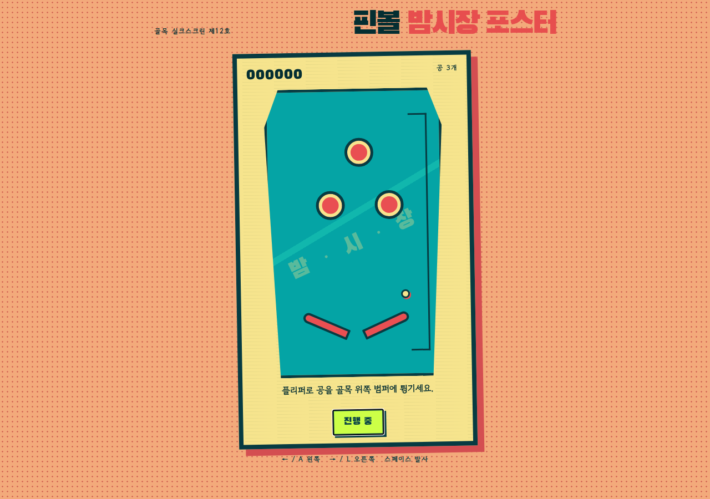
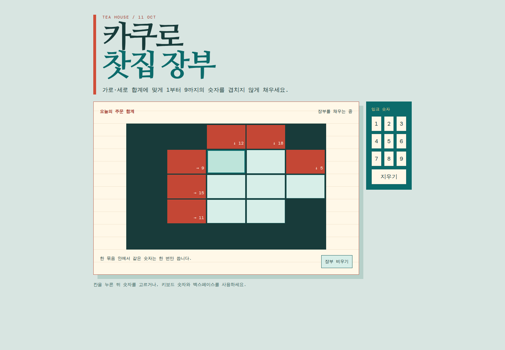
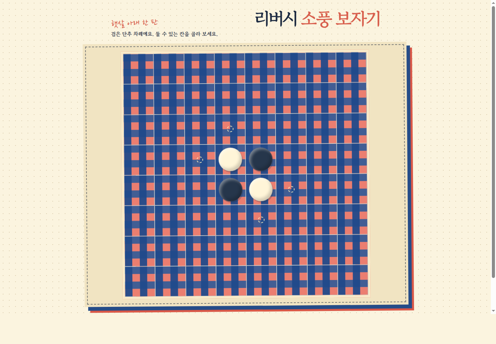
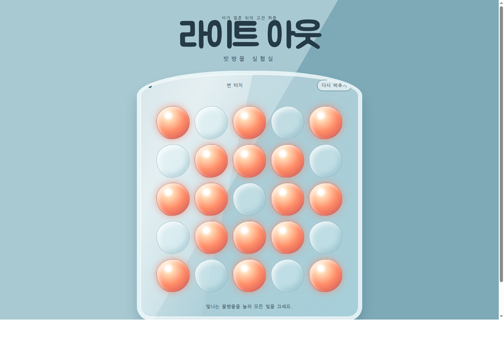

# 데일리 클래식 게임

날짜별로 작은 클래식 브라우저 게임을 모아두는 저장소입니다. 각 게임은 새 의존성 없이 정적 HTML, CSS, JavaScript만 사용합니다.

이전 게임 설명과 화면은 [아카이브](archive/README-games.md)에 보관합니다.

## 최근 게임 목록

| 날짜 | 게임 | 설명 |
| --- | --- | --- |
| 2026-10-18 | [마작 패 맞추기 · 청사진 조선소](daily/2026-10-18-battleship-blueprint/index.html) | 밝은 조선소 청사진의 패 작업대에서 좌우가 열린 같은 패을 짝지어 치우는 고전 마작 맞추기입니다. |
| 2026-10-17 | [소코반 · 성냥갑 창고](daily/2026-10-17-sokoban-matchbox/index.html) | 청회색 벽돌 창고에서 상자 하나를 붉은 목표 칸까지 미는 고전 소코반입니다. |
| 2026-10-16 | [미니 스도쿠 · 종이접기 도감](daily/2026-10-16-mini-sudoku-origami/index.html) | 접힌 종이 도감의 4×4 칸에 1부터 4까지를 맞물리게 넣는 작은 고전 스도쿠 퍼즐입니다. |
| 2026-10-15 | [수라카르타 · 항구 해도](daily/2026-10-15-surakarta-harbor-chart/index.html) | 항구 해도의 순환 고리를 지나 상대 말을 잡는 인도네시아 고전 수라카르타입니다. |
| 2026-10-14 | [필로스 · 수련 온실](daily/2026-10-14-pylos-lily-greenhouse/index.html) | 유리 수련 받침 위에 청록과 산호 구슬을 차례로 올려 꼭대기를 먼저 완성하는 고전 필로스 게임입니다. |
| 2026-10-13 | [빙고 · 해변 구조대 전광판](daily/2026-10-13-bingo-lifeguard-board/index.html) | 해변 구조대의 기계식 호출판에서 뽑힌 번호를 찾아 깃발을 올리고 한 줄을 완성하는 고전 빙고 게임입니다. |
| 2026-10-12 | [핀볼 · 밤시장 포스터](daily/2026-10-12-pinball-poster/index.html) | 형광 실크스크린 골목 포스터에서 플리퍼로 공을 튕겨 범퍼를 맞히는 고전 핀볼 게임입니다. |
| 2026-10-11 | [카쿠로 · 찻집 장부](daily/2026-10-11-kakuro-tea-ledger/index.html) | 크림 장부의 가로·세로 주문 합계에 맞춰 숫자를 채우는 고전 카쿠로 퍼즐입니다. |
| 2026-10-10 | [리버시 · 소풍 보자기](daily/2026-10-10-reversi-picnic-cloth/index.html) | 빨강·파랑 체크 보자기 위에 나무 단추를 놓아 상대 단추를 뒤집는 고전 리버시 게임입니다. |
| 2026-10-09 | [라이트 아웃 · 빗방울 실험실](daily/2026-10-09-lights-out-rain-lab/index.html) | 비 내린 유리창의 빛나는 물방울을 눌러 십자 모양 이웃과 함께 모두 끄는 고전 라이트 아웃 퍼즐입니다. |

## 최근 게임 화면

### 마작 패 맞추기 · 청사진 조선소


[게임 파일](daily/2026-10-18-battleship-blueprint/index.html) · [모바일 화면](daily/2026-10-18-battleship-blueprint/screenshot-mobile.png) · [디자인 비교와 검증](daily/2026-10-18-battleship-blueprint/DESIGN.md)

### 소코반 · 성냥갑 창고


[게임 파일](daily/2026-10-17-sokoban-matchbox/index.html) · [모바일 화면](daily/2026-10-17-sokoban-matchbox/screenshot-mobile.png) · [디자인 비교와 검증](daily/2026-10-17-sokoban-matchbox/DESIGN.md)

### 미니 스도쿠 · 종이접기 도감


[게임 파일](daily/2026-10-16-mini-sudoku-origami/index.html) · [모바일 화면](daily/2026-10-16-mini-sudoku-origami/screenshot-mobile.png) · [디자인 비교와 검증](daily/2026-10-16-mini-sudoku-origami/DESIGN.md)

### 수라카르타 · 항구 해도


[게임 파일](daily/2026-10-15-surakarta-harbor-chart/index.html) · [모바일 화면](daily/2026-10-15-surakarta-harbor-chart/screenshot-mobile.png) · [디자인 비교와 검증](daily/2026-10-15-surakarta-harbor-chart/DESIGN.md)

### 필로스 · 수련 온실


[게임 파일](daily/2026-10-14-pylos-lily-greenhouse/index.html) · [모바일 화면](daily/2026-10-14-pylos-lily-greenhouse/screenshot-mobile.png) · [디자인 비교와 검증](daily/2026-10-14-pylos-lily-greenhouse/DESIGN.md)

### 빙고 · 해변 구조대 전광판


[게임 파일](daily/2026-10-13-bingo-lifeguard-board/index.html) · [모바일 화면](daily/2026-10-13-bingo-lifeguard-board/screenshot-mobile.png) · [디자인 비교와 검증](daily/2026-10-13-bingo-lifeguard-board/DESIGN.md)

### 핀볼 · 밤시장 포스터



[게임 파일](daily/2026-10-12-pinball-poster/index.html) · [모바일 화면](daily/2026-10-12-pinball-poster/screenshot-mobile.png) · [디자인 비교와 검증](daily/2026-10-12-pinball-poster/DESIGN.md)

### 카쿠로 · 찻집 장부



[게임 파일](daily/2026-10-11-kakuro-tea-ledger/index.html) · [모바일 화면](daily/2026-10-11-kakuro-tea-ledger/screenshot-mobile.png) · [디자인 비교와 검증](daily/2026-10-11-kakuro-tea-ledger/DESIGN.md)

### 리버시 · 소풍 보자기



[게임 파일](daily/2026-10-10-reversi-picnic-cloth/index.html) · [모바일 화면](daily/2026-10-10-reversi-picnic-cloth/screenshot-mobile.png) · [디자인 비교와 검증](daily/2026-10-10-reversi-picnic-cloth/DESIGN.md)

### 라이트 아웃 · 빗방울 실험실



[게임 파일](daily/2026-10-09-lights-out-rain-lab/index.html) · [모바일 화면](daily/2026-10-09-lights-out-rain-lab/screenshot-mobile.png) · [디자인 비교와 검증](daily/2026-10-09-lights-out-rain-lab/DESIGN.md)


## 테스트

로직 테스트는 Node.js 내장 모듈만 사용합니다.

```bash
node daily/2026-10-18-battleship-blueprint/game-logic.test.js
node daily/2026-10-17-sokoban-matchbox/game-logic.test.js
node daily/2026-10-16-mini-sudoku-origami/game-logic.test.js
node daily/2026-10-15-surakarta-harbor-chart/game-logic.test.js
node daily/2026-10-14-pylos-lily-greenhouse/game-logic.test.js
node daily/2026-10-13-bingo-lifeguard-board/game-logic.test.js
node daily/2026-10-12-pinball-poster/game-logic.test.js
node daily/2026-10-11-kakuro-tea-ledger/game-logic.test.js
node daily/2026-10-10-reversi-picnic-cloth/game-logic.test.js
node daily/2026-10-09-lights-out-rain-lab/game-logic.test.js
node daily/2026-10-08-hanoi-library-ladder/game-logic.test.js
node daily/2026-10-07-lunar-lander-kite-festival/game-logic.test.js
node daily/2026-10-06-yutnori-roofyard/game-logic.test.js
node daily/2026-10-05-2048-printshop/game-logic.test.js
node daily/2026-10-04-snake-signal/game-logic.test.js
node daily/2026-10-03-atari-go-clay-grid/game-logic.test.js
node daily/2026-10-02-mastermind-punchcard/game-logic.test.js
node daily/2026-10-01-minesweeper-weather-map/game-logic.test.js
node daily/2026-09-30-pente-neon-court/game-logic.test.js
node daily/2026-09-29-boggle-typecase/game-logic.test.js
node daily/2026-09-28-kalaha-tide-pools/game-logic.test.js
node daily/2026-09-27-mini-draughts/game-logic.test.js
node daily/2026-09-26-alquerque/game-logic.test.js
node daily/2026-09-25-connect-four/game-logic.test.js
node daily/2026-09-24-fifteen-puzzle/game-logic.test.js
node daily/2026-09-23-tic-tac-toe/game-logic.test.js
node daily/2026-09-22-nim-sticks/game-logic.test.js
node daily/2026-09-20-fox-and-geese/game-logic.test.js
node daily/2026-09-14-shuffleboard/game-logic.test.js
node daily/2026-09-13-bagatelle/game-logic.test.js
node daily/2026-09-12-ming-mang/game-logic.test.js
node daily/2026-09-11-awithlaknannai/game-logic.test.js
node daily/2026-09-10-mini-fanorona/game-logic.test.js
node daily/2026-09-09-umul-gonu/game-logic.test.js
node daily/2026-09-08-latrunculi/game-logic.test.js
node daily/2026-09-07-shisima/game-logic.test.js
node daily/2026-09-06-mini-hasami-shogi/game-logic.test.js
node daily/2026-09-05-seega/game-logic.test.js
node daily/2026-09-04-mini-halma/game-logic.test.js
node daily/2026-09-03-frog-leap/game-logic.test.js
node daily/2026-09-02-yote/game-logic.test.js
node daily/2026-09-01-dara/game-logic.test.js
node daily/2026-08-31-picaria/game-logic.test.js
node daily/2026-08-30-chopsticks/game-logic.test.js
node daily/2026-08-29-six-mens-morris/game-logic.test.js
node daily/2026-08-28-five-field-kono/game-logic.test.js
node daily/2026-08-27-tafl/game-logic.test.js
node daily/2026-08-26-gaps-solitaire/game-logic.test.js
node daily/2026-08-25-quarto/game-logic.test.js
node daily/2026-08-24-mini-freecell/game-logic.test.js
node daily/2026-08-23-dominoes/game-logic.test.js
node daily/2026-08-22-crazy-eights/game-logic.test.js
node daily/2026-08-21-klondike-solitaire/game-logic.test.js
node daily/2026-08-20-nonogram/game-logic.test.js
node daily/2026-08-19-aces-up-solitaire/game-logic.test.js
node daily/2026-08-18-peg-solitaire/game-logic.test.js
node daily/2026-08-17-teeko/game-logic.test.js
```
