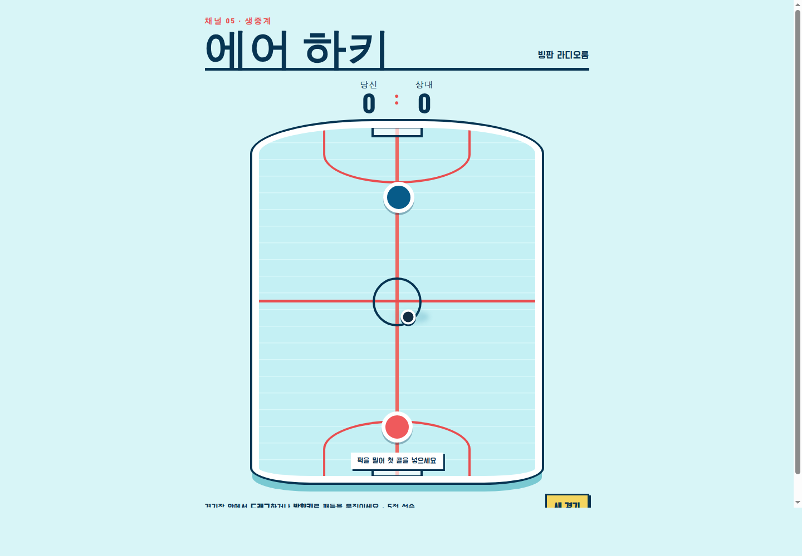
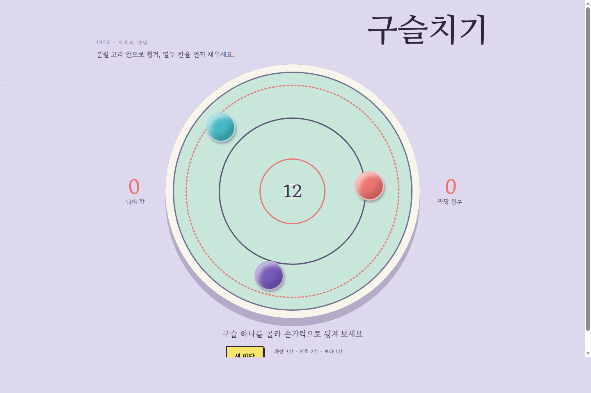
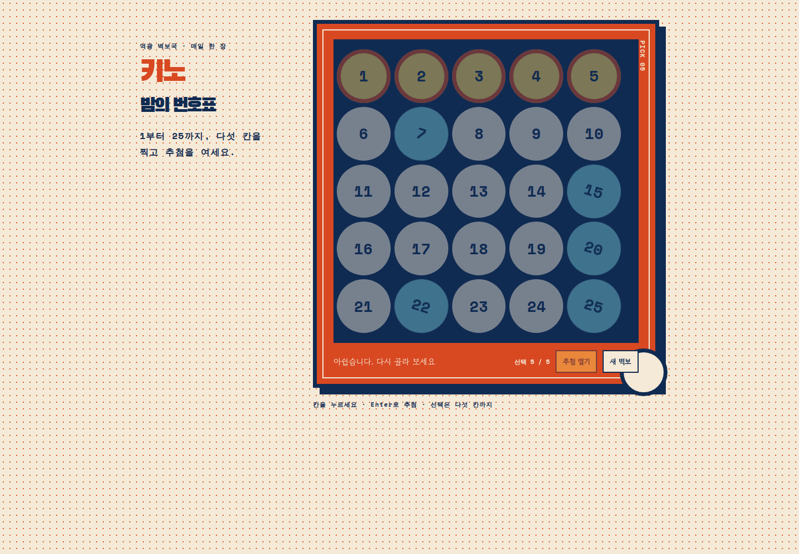
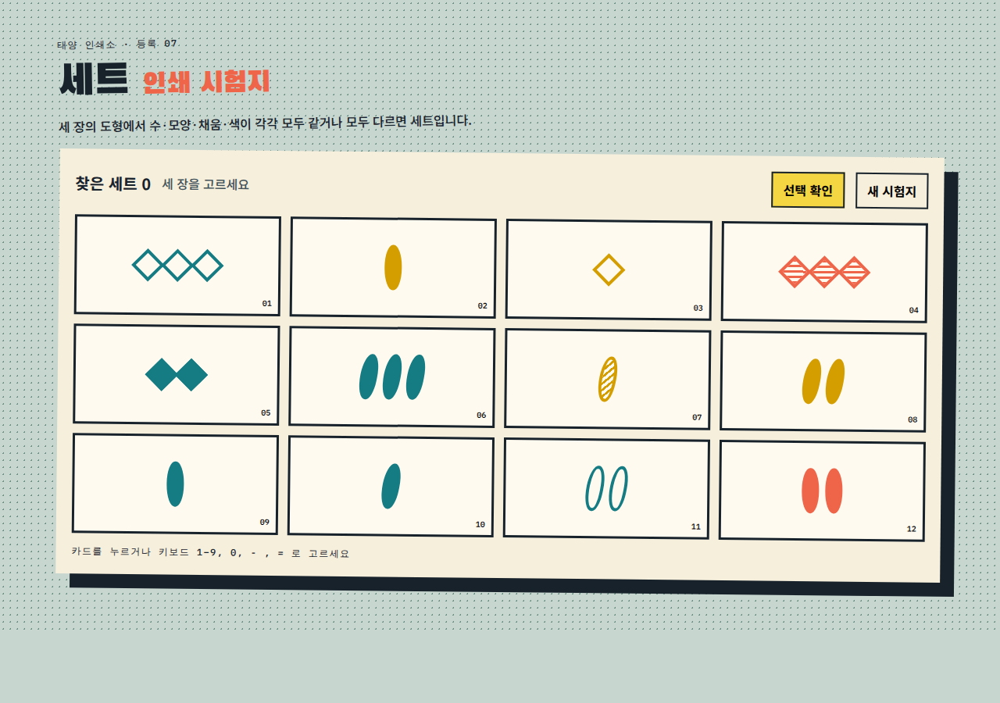
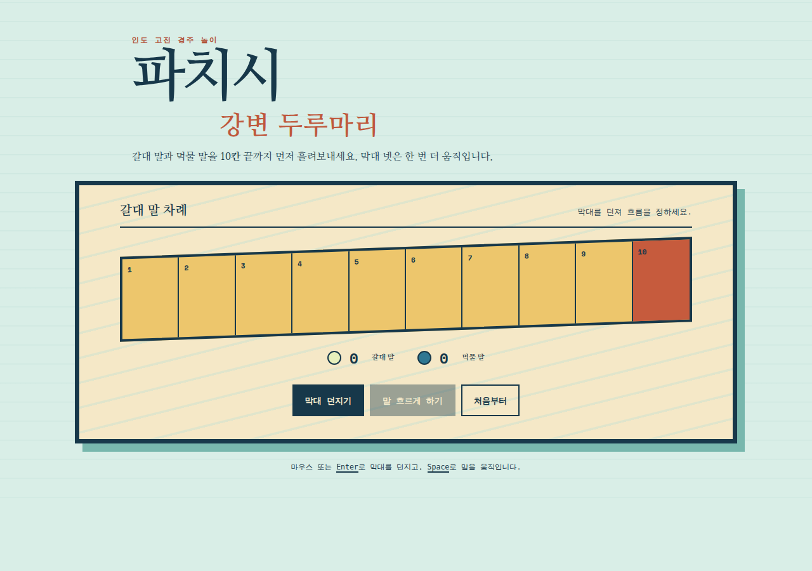
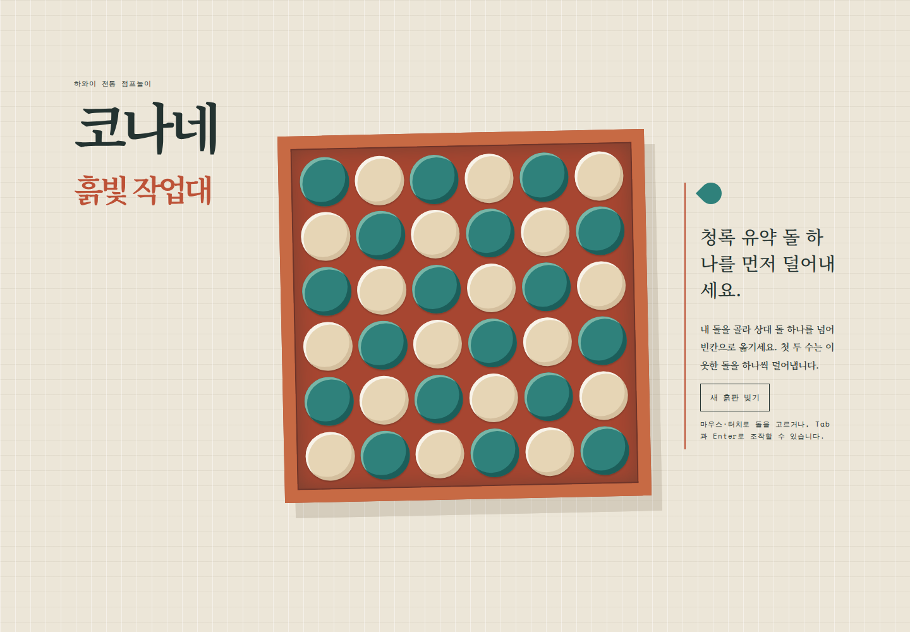
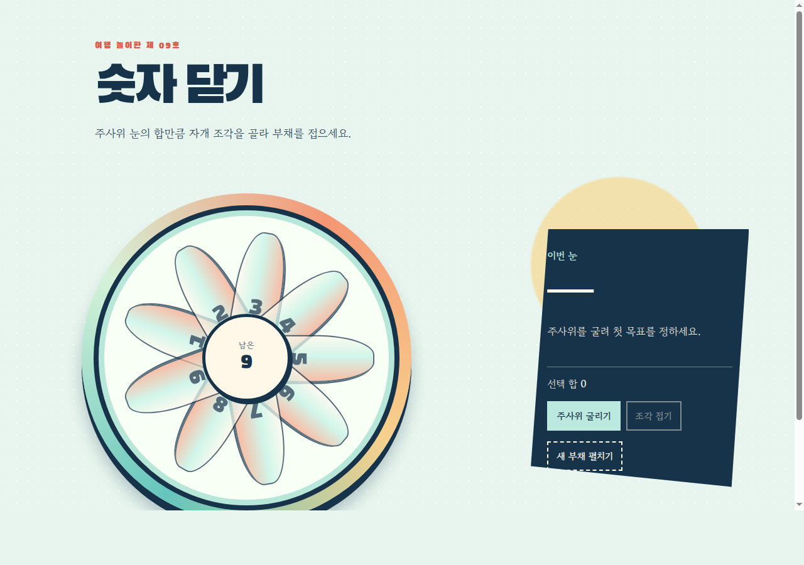
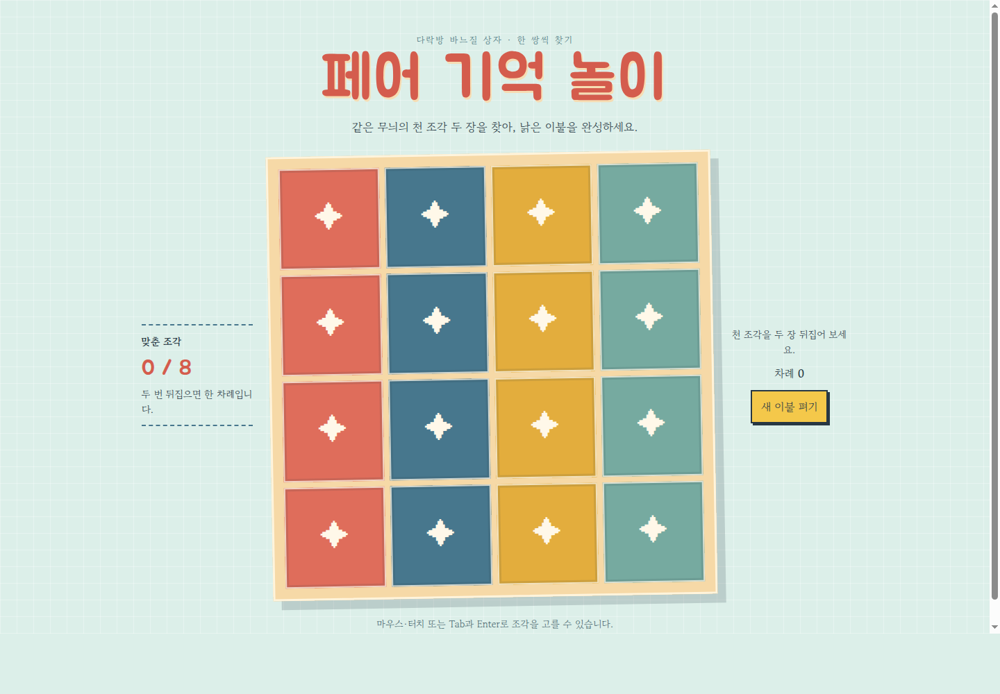
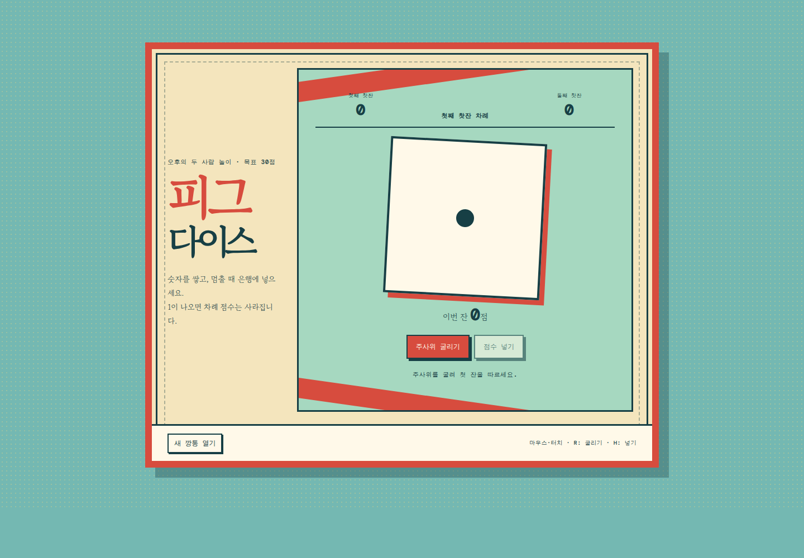

# 데일리 클래식 게임

날짜별로 작은 클래식 브라우저 게임을 모아두는 저장소입니다. 각 게임은 새 의존성 없이 정적 HTML, CSS, JavaScript만 사용합니다.

이전 게임 설명과 화면은 [아카이브](archive/README-games.md)에 보관합니다.

## 최근 게임 목록

| 날짜 | 게임 | 설명 |
| --- | --- | --- |
| 2026-11-10 | [에어 하키 · 빙판 라디오룸](daily/2026-11-10-air-hockey-ice-rink/index.html) | 서리 낀 청록 아이스 링크에서 패들을 움직여 퍽을 튕기고 5점을 먼저 내는 고전 에어 하키입니다. |
| 2026-11-09 | [구슬치기 · 분필 마당](daily/2026-11-09-marble-flick-yard/index.html) | 라일락 석회 마당의 원형 분필 고리로 유리 구슬을 튕겨 열두 칸을 먼저 채우는 고전 구슬치기입니다. |
| 2026-11-08 | [키노 · 역광 벽보국](daily/2026-11-08-keno-poster/index.html) | 주황과 남색의 밤 벽보에서 다섯 번호를 찍고 추첨 번호와의 적중을 확인하는 고전 키노입니다. |
| 2026-11-07 | [세트 · 태양 인쇄소](daily/2026-11-07-set-solar-studio/index.html) | 형광 잉크 시험지에서 수·모양·채움·색이 모두 같거나 모두 다른 세 장을 찾는 고전 세트입니다. |
| 2026-11-06 | [파치시 · 강변 두루마리](daily/2026-11-06-pachisi-river-scroll/index.html) | 민트 수면의 기울어진 파피루스 수로에서 갈대 말과 먹물 말을 10칸 끝까지 먼저 흘려보내는 인도 고전 파치시 경주입니다. |
| 2026-11-05 | [코나네 · 흙빛 작업대](daily/2026-11-05-puluc-clay-studio/index.html) | 석고 작업대의 청록·백토 돌을 뛰어넘어 길을 끊는 하와이 전통 코나네 게임입니다. |
| 2026-11-04 | [숫자 닫기 · 자개 부채판](daily/2026-11-04-shut-the-box-shell/index.html) | 바다빛 자개 부채판에서 주사위 합과 같은 숫자 조각을 접어 모두 닫는 고전 숫자 닫기입니다. |
| 2026-11-03 | [페어 기억 놀이 · 다락방 퀼트](daily/2026-11-03-memory-quilt/index.html) | 밝은 다락방 퀼트 조각을 두 장씩 뒤집어 같은 무늬를 찾아 이불을 완성하는 고전 페어 기억 놀이입니다. |
| 2026-11-02 | [시장 풍탄 · 항구 전표](daily/2026-11-02-fan-tan-market/index.html) | 청회색 항구 전표의 숫자 선반에서 2번부터 이웃 패를 잇는 고전 풍탄 카드 게임입니다. |
| 2026-11-01 | [피그 다이스 · 홍차 깡통](daily/2026-11-01-pig-dice-tea-tin/index.html) | 청록 차통 라벨 위에서 주사위를 굴려 30점을 먼저 은행에 넣는 두 사람 고전 피그 다이스입니다. |

## 최근 게임 화면

### 에어 하키 · 빙판 라디오룸



[게임 파일](daily/2026-11-10-air-hockey-ice-rink/index.html) · [모바일 화면](daily/2026-11-10-air-hockey-ice-rink/screenshot-mobile.png) · [디자인 비교와 검증](daily/2026-11-10-air-hockey-ice-rink/DESIGN.md)

### 구슬치기 · 분필 마당



[게임 파일](daily/2026-11-09-marble-flick-yard/index.html) · [모바일 화면](daily/2026-11-09-marble-flick-yard/screenshot-mobile.png) · [디자인 비교와 검증](daily/2026-11-09-marble-flick-yard/DESIGN.md)

### 키노 · 역광 벽보국



[게임 파일](daily/2026-11-08-keno-poster/index.html) · [모바일 화면](daily/2026-11-08-keno-poster/screenshot-mobile.png) · [디자인 비교와 검증](daily/2026-11-08-keno-poster/DESIGN.md)

### 세트 · 태양 인쇄소



[게임 파일](daily/2026-11-07-set-solar-studio/index.html) · [모바일 화면](daily/2026-11-07-set-solar-studio/screenshot-mobile.png) · [디자인 비교와 검증](daily/2026-11-07-set-solar-studio/DESIGN.md)

### 파치시 · 강변 두루마리



[게임 파일](daily/2026-11-06-pachisi-river-scroll/index.html) · [모바일 화면](daily/2026-11-06-pachisi-river-scroll/screenshot-mobile.png) · [디자인 비교와 검증](daily/2026-11-06-pachisi-river-scroll/DESIGN.md)

### 코나네 · 흙빛 작업대



[게임 파일](daily/2026-11-05-puluc-clay-studio/index.html) · [모바일 화면](daily/2026-11-05-puluc-clay-studio/screenshot-mobile.png) · [디자인 비교와 검증](daily/2026-11-05-puluc-clay-studio/DESIGN.md)

### 숫자 닫기 · 자개 부채판



[게임 파일](daily/2026-11-04-shut-the-box-shell/index.html) · [모바일 화면](daily/2026-11-04-shut-the-box-shell/screenshot-mobile.png) · [디자인 비교와 검증](daily/2026-11-04-shut-the-box-shell/DESIGN.md)

### 페어 기억 놀이 · 다락방 퀼트



[게임 파일](daily/2026-11-03-memory-quilt/index.html) · [모바일 화면](daily/2026-11-03-memory-quilt/screenshot-mobile.png) · [디자인 비교와 검증](daily/2026-11-03-memory-quilt/DESIGN.md)

### 시장 풍탄 · 항구 전표


[게임 파일](daily/2026-11-02-fan-tan-market/index.html) · [모바일 화면](daily/2026-11-02-fan-tan-market/screenshot-mobile.png) · [디자인 비교와 검증](daily/2026-11-02-fan-tan-market/DESIGN.md)

### 피그 다이스 · 홍차 깡통



[게임 파일](daily/2026-11-01-pig-dice-tea-tin/index.html) · [모바일 화면](daily/2026-11-01-pig-dice-tea-tin/screenshot-mobile.png) · [디자인 비교와 검증](daily/2026-11-01-pig-dice-tea-tin/DESIGN.md)

## 테스트

로직 테스트는 Node.js 내장 모듈만 사용합니다.

```bash
node daily/2026-11-10-air-hockey-ice-rink/game-logic.test.js
node daily/2026-11-09-marble-flick-yard/game-logic.test.js
node daily/2026-11-08-keno-poster/game-logic.test.js
node daily/2026-11-07-set-solar-studio/game-logic.test.js
node daily/2026-11-06-pachisi-river-scroll/game-logic.test.js
node daily/2026-11-05-puluc-clay-studio/game-logic.test.js
node daily/2026-11-04-shut-the-box-shell/game-logic.test.js
node daily/2026-11-03-memory-quilt/game-logic.test.js
node daily/2026-11-02-fan-tan-market/game-logic.test.js
node daily/2026-11-01-pig-dice-tea-tin/game-logic.test.js
node daily/2026-10-31-cribbage-cloth-table/game-logic.test.js
node daily/2026-10-30-paper-football-scoreboard/game-logic.test.js
node daily/2026-10-29-peg-solitaire-orbit/game-logic.test.js
node daily/2026-10-28-pong-gymnasium/game-logic.test.js
node daily/2026-10-27-backgammon-travel-poster/game-logic.test.js
node daily/2026-10-26-chinese-checkers-festival/game-logic.test.js
node daily/2026-10-25-ninepins-seaside/game-logic.test.js
node daily/2026-10-23-klotski-studio/game-logic.test.js
node daily/2026-10-21-quoridor-subway/game-logic.test.js
node daily/2026-10-20-yahtzee-letterpress/game-logic.test.js
node daily/2026-10-19-simon-glasshouse-chimes/game-logic.test.js
node daily/2026-10-18-battleship-blueprint/game-logic.test.js
node daily/2026-10-16-mini-sudoku-origami/game-logic.test.js
node daily/2026-10-14-pylos-lily-greenhouse/game-logic.test.js
node daily/2026-10-13-bingo-lifeguard-board/game-logic.test.js
node daily/2026-10-11-kakuro-tea-ledger/game-logic.test.js
node daily/2026-10-10-reversi-picnic-cloth/game-logic.test.js
node daily/2026-10-09-lights-out-rain-lab/game-logic.test.js
node daily/2026-10-08-hanoi-library-ladder/game-logic.test.js
node daily/2026-10-07-lunar-lander-kite-festival/game-logic.test.js
node daily/2026-10-06-yutnori-roofyard/game-logic.test.js
node daily/2026-10-05-2048-printshop/game-logic.test.js
node daily/2026-10-04-snake-signal/game-logic.test.js
node daily/2026-10-03-atari-go-clay-grid/game-logic.test.js
node daily/2026-10-02-mastermind-punchcard/game-logic.test.js
node daily/2026-10-01-minesweeper-weather-map/game-logic.test.js
node daily/2026-09-30-pente-neon-court/game-logic.test.js
node daily/2026-09-29-boggle-typecase/game-logic.test.js
node daily/2026-09-28-kalaha-tide-pools/game-logic.test.js
node daily/2026-09-27-mini-draughts/game-logic.test.js
node daily/2026-09-26-alquerque/game-logic.test.js
node daily/2026-09-25-connect-four/game-logic.test.js
node daily/2026-09-24-fifteen-puzzle/game-logic.test.js
node daily/2026-09-23-tic-tac-toe/game-logic.test.js
node daily/2026-09-22-nim-sticks/game-logic.test.js
node daily/2026-09-20-fox-and-geese/game-logic.test.js
node daily/2026-09-14-shuffleboard/game-logic.test.js
node daily/2026-09-13-bagatelle/game-logic.test.js
node daily/2026-09-12-ming-mang/game-logic.test.js
node daily/2026-09-11-awithlaknannai/game-logic.test.js
node daily/2026-09-10-mini-fanorona/game-logic.test.js
node daily/2026-09-09-umul-gonu/game-logic.test.js
node daily/2026-09-08-latrunculi/game-logic.test.js
node daily/2026-09-07-shisima/game-logic.test.js
node daily/2026-09-06-mini-hasami-shogi/game-logic.test.js
node daily/2026-09-05-seega/game-logic.test.js
node daily/2026-09-04-mini-halma/game-logic.test.js
node daily/2026-09-03-frog-leap/game-logic.test.js
node daily/2026-09-02-yote/game-logic.test.js
node daily/2026-09-01-dara/game-logic.test.js
node daily/2026-08-31-picaria/game-logic.test.js
node daily/2026-08-30-chopsticks/game-logic.test.js
node daily/2026-08-29-six-mens-morris/game-logic.test.js
node daily/2026-08-28-five-field-kono/game-logic.test.js
node daily/2026-08-27-tafl/game-logic.test.js
node daily/2026-08-26-gaps-solitaire/game-logic.test.js
node daily/2026-08-25-quarto/game-logic.test.js
node daily/2026-08-24-mini-freecell/game-logic.test.js
node daily/2026-08-23-dominoes/game-logic.test.js
node daily/2026-08-22-crazy-eights/game-logic.test.js
node daily/2026-08-21-klondike-solitaire/game-logic.test.js
node daily/2026-08-20-nonogram/game-logic.test.js
node daily/2026-08-19-aces-up-solitaire/game-logic.test.js
node daily/2026-08-18-peg-solitaire/game-logic.test.js
node daily/2026-08-17-teeko/game-logic.test.js
```
