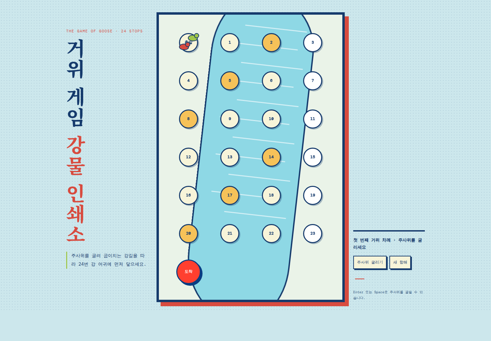
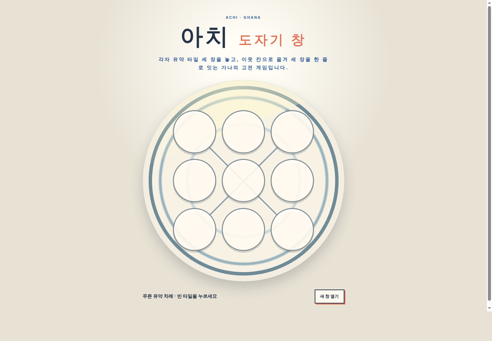
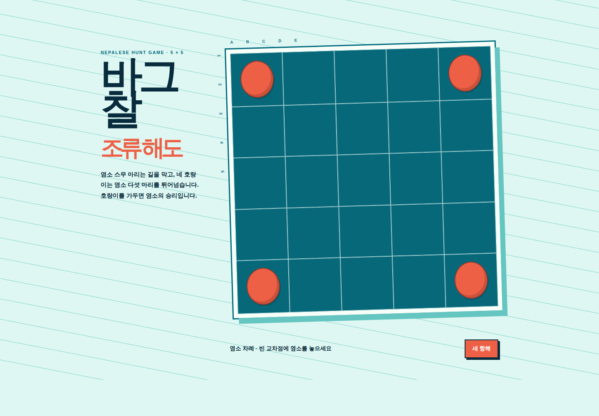
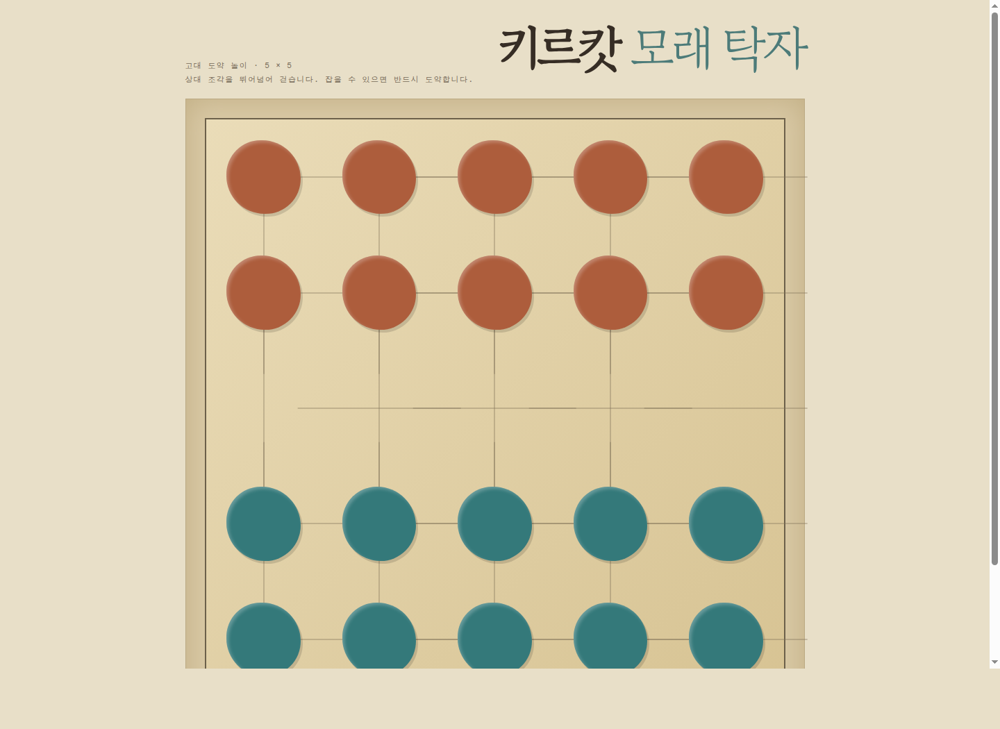
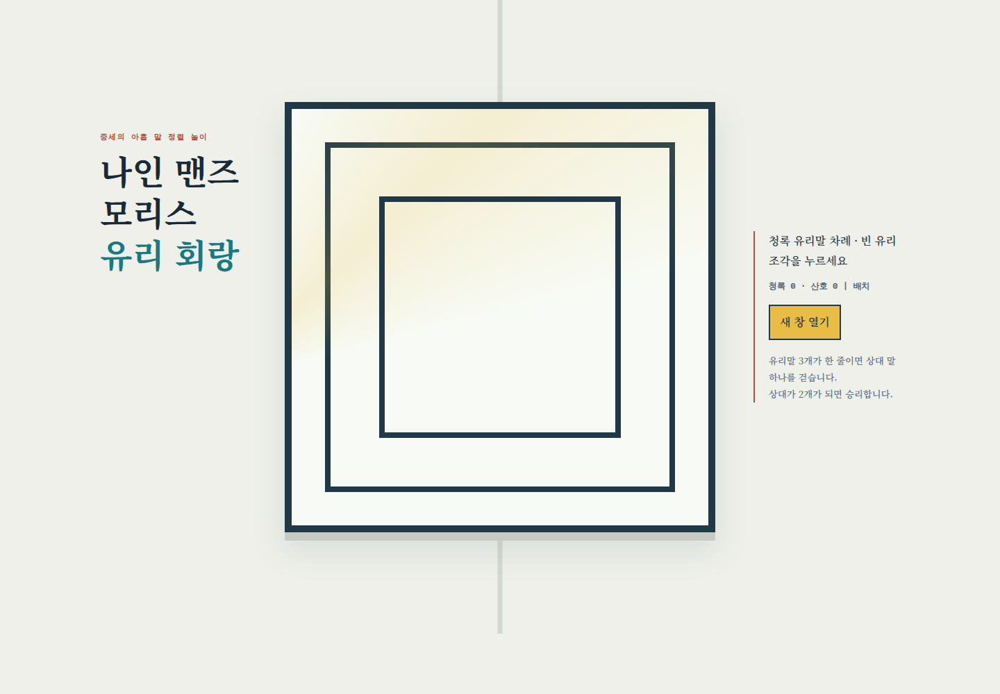
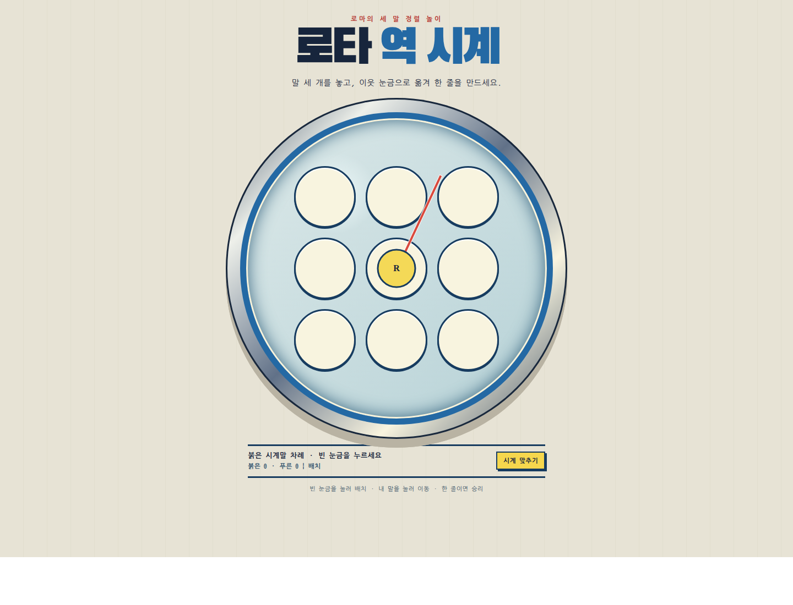
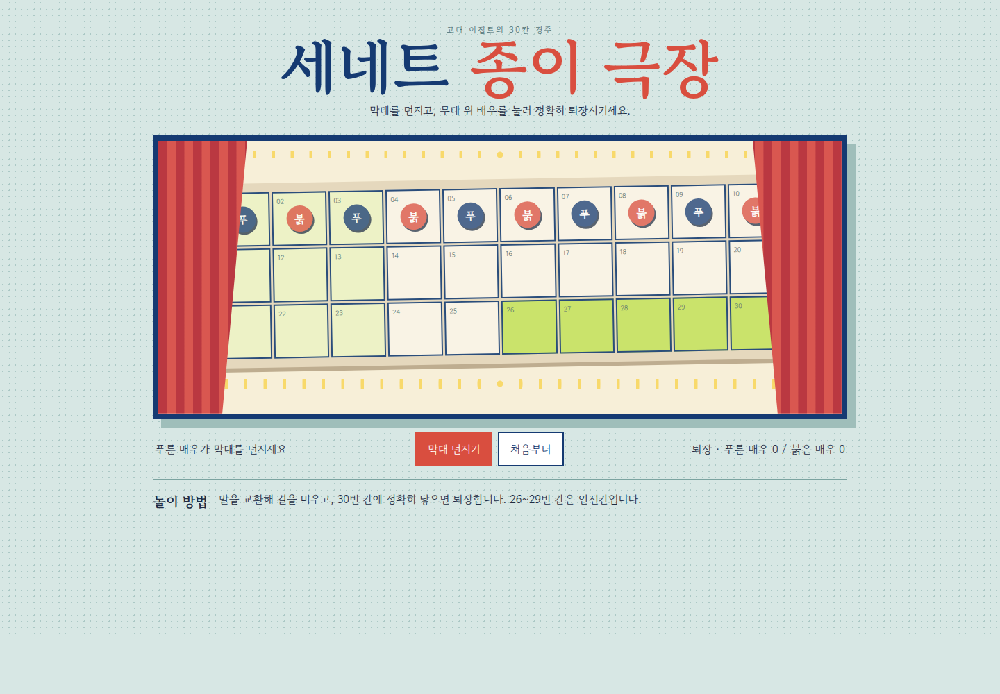
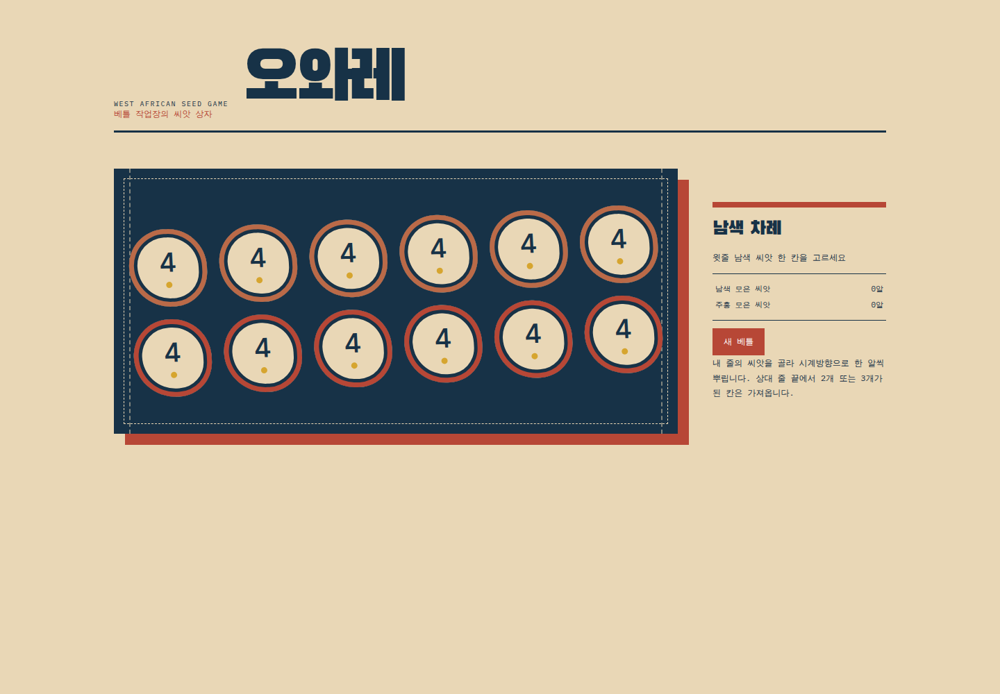

# 데일리 클래식 게임

날짜별로 작은 클래식 브라우저 게임을 모아두는 저장소입니다. 각 게임은 새 의존성 없이 정적 HTML, CSS, JavaScript만 사용합니다.

이전 게임 설명과 화면은 [아카이브](archive/README-games.md)에 보관합니다.

## 최근 게임 목록

| 날짜 | 게임 | 설명 |
| --- | --- | --- |
| 2026-11-28 | [거위 게임 · 강물 인쇄소](daily/2026-11-28-goose-river-print/index.html) | 하늘빛 실크스크린 강 지도에서 주사위를 굴려 24번 강 어귀에 먼저 닿는 유럽 고전 거위 게임입니다. |
| 2026-11-27 | [아치 · 도자기 창](daily/2026-11-27-achi-ceramic-window/index.html) | 석회 벽의 원형 도자기 창에서 푸른 유약과 살구 유약 타일을 이웃 칸으로 옮겨 세 장을 먼저 잇는 가나 고전 아치입니다. |
| 2026-11-26 | [바그 찰 · 조류 해도](daily/2026-11-26-konane-tide-chart/index.html) | 청록 해도 위에서 염소 스무 마리와 호랑이 네 마리가 서로 길을 막고 뛰어넘는 네팔 고전 바그 찰입니다. |
| 2026-11-24 | [키르캇 · 모래 탁자](daily/2026-11-24-qirkat-sand-table/index.html) | 햇빛 어린 모래 발굴판에서 청록과 적토 안료 조각으로 상대를 뛰어넘어 걷는 고대 키르캇입니다. |
| 2026-11-23 | [나인 맨즈 모리스 · 유리 회랑](daily/2026-11-23-nine-mens-morris-glass-cloister/index.html) | 성당의 청록·산호 색유리 회랑에서 아홉 말을 한 줄로 세워 상대 말을 걷는 고전 나인 맨즈 모리스입니다. |
| 2026-11-22 | [로타 · 역 시계](daily/2026-11-22-rota-station-clock/index.html) | 밝은 역 시계의 아홉 눈금에서 붉은 말과 푸른 말을 이웃 칸으로 옮겨 한 줄을 먼저 만드는 고대 로타입니다. |
| 2026-11-21 | [세네트 · 종이 극장](daily/2026-11-21-senet-paper-theater/index.html) | 크림 인쇄지 극장의 긴 30칸 무대에서 푸른 배우와 붉은 배우를 교환하며 정확히 퇴장시키는 고전 세네트입니다. |
| 2026-11-20 | [오와레 · 베틀 작업장](daily/2026-11-20-oware-weavers-loom/index.html) | 청남색 베틀 위 씨앗 상자에서 씨앗을 뿌리고 둘·셋 알이 된 상대 칸을 거두는 서아프리카 고전 오와레입니다. |
| 2026-11-19 | [우르 왕실 경기 · 점토 경주](daily/2026-11-19-ur-clay-race/index.html) | 테라코타 점토 경주길에서 남빛과 토빛 말을 로제트 칸으로 이끌어 일곱 말을 먼저 도착시키는 고전 우르 왕실 경기입니다. |
| 2026-11-18 | [천점 주사위 · 세탁표 교환소](daily/2026-11-18-farkle-laundry-token/index.html) | 회백색 세탁 전표 위에서 점수 눈을 골라 보관하며 1000점을 먼저 채우는 고전 천점 주사위입니다. |

## 최근 게임 화면

### 거위 게임 · 강물 인쇄소



[게임 파일](daily/2026-11-28-goose-river-print/index.html) · [모바일 화면](daily/2026-11-28-goose-river-print/screenshot-mobile.png) · [디자인 비교와 검증](daily/2026-11-28-goose-river-print/DESIGN.md)

### 아치 · 도자기 창



[게임 파일](daily/2026-11-27-achi-ceramic-window/index.html) · [모바일 화면](daily/2026-11-27-achi-ceramic-window/screenshot-mobile.png) · [디자인 비교와 검증](daily/2026-11-27-achi-ceramic-window/DESIGN.md)

### 바그 찰 · 조류 해도



[게임 파일](daily/2026-11-26-konane-tide-chart/index.html) · [모바일 화면](daily/2026-11-26-konane-tide-chart/screenshot-mobile.png) · [디자인 비교와 검증](daily/2026-11-26-konane-tide-chart/DESIGN.md)

### 키르캇 · 모래 탁자



[게임 파일](daily/2026-11-24-qirkat-sand-table/index.html) · [모바일 화면](daily/2026-11-24-qirkat-sand-table/screenshot-mobile.png) · [디자인 비교와 검증](daily/2026-11-24-qirkat-sand-table/DESIGN.md)

### 나인 맨즈 모리스 · 유리 회랑



[게임 파일](daily/2026-11-23-nine-mens-morris-glass-cloister/index.html) · [모바일 화면](daily/2026-11-23-nine-mens-morris-glass-cloister/screenshot-mobile.png) · [디자인 비교와 검증](daily/2026-11-23-nine-mens-morris-glass-cloister/DESIGN.md)

### 로타 · 역 시계



[게임 파일](daily/2026-11-22-rota-station-clock/index.html) · [모바일 화면](daily/2026-11-22-rota-station-clock/screenshot-mobile.png) · [디자인 비교와 검증](daily/2026-11-22-rota-station-clock/DESIGN.md)

### 세네트 · 종이 극장



[게임 파일](daily/2026-11-21-senet-paper-theater/index.html) · [모바일 화면](daily/2026-11-21-senet-paper-theater/screenshot-mobile.png) · [디자인 비교와 검증](daily/2026-11-21-senet-paper-theater/DESIGN.md)

### 오와레 · 베틀 작업장



[게임 파일](daily/2026-11-20-oware-weavers-loom/index.html) · [모바일 화면](daily/2026-11-20-oware-weavers-loom/screenshot-mobile.png) · [디자인 비교와 검증](daily/2026-11-20-oware-weavers-loom/DESIGN.md)

### 우르 왕실 경기 · 점토 경주


[게임 파일](daily/2026-11-19-ur-clay-race/index.html) · [모바일 화면](daily/2026-11-19-ur-clay-race/screenshot-mobile.png) · [디자인 비교와 검증](daily/2026-11-19-ur-clay-race/DESIGN.md)

### 천점 주사위 · 세탁표 교환소


[게임 파일](daily/2026-11-18-farkle-laundry-token/index.html) · [모바일 화면](daily/2026-11-18-farkle-laundry-token/screenshot-mobile.png) · [디자인 비교와 검증](daily/2026-11-18-farkle-laundry-token/DESIGN.md)

## 테스트

로직 테스트는 Node.js 내장 모듈만 사용합니다.

```bash
node daily/2026-11-28-goose-river-print/game-logic.test.js
node daily/2026-11-27-achi-ceramic-window/game-logic.test.js
node daily/2026-11-26-konane-tide-chart/game-logic.test.js
node daily/2026-11-24-qirkat-sand-table/game-logic.test.js
node daily/2026-11-23-nine-mens-morris-glass-cloister/game-logic.test.js
node daily/2026-11-22-rota-station-clock/game-logic.test.js
node daily/2026-11-21-senet-paper-theater/game-logic.test.js
node daily/2026-11-20-oware-weavers-loom/game-logic.test.js
node daily/2026-11-19-ur-clay-race/game-logic.test.js
node daily/2026-11-18-farkle-laundry-token/game-logic.test.js
node daily/2026-11-15-hex-coral-walk/game-logic.test.js
node daily/2026-11-14-dots-post-office/game-logic.test.js
node daily/2026-11-13-jacks-courtyard/game-logic.test.js
node daily/2026-11-12-skee-ball-ticket-booth/game-logic.test.js
node daily/2026-11-11-darts-wayfinding/game-logic.test.js
node daily/2026-11-09-marble-flick-yard/game-logic.test.js
node daily/2026-11-07-set-solar-studio/game-logic.test.js
node daily/2026-11-06-pachisi-river-scroll/game-logic.test.js
node daily/2026-11-05-puluc-clay-studio/game-logic.test.js
node daily/2026-11-04-shut-the-box-shell/game-logic.test.js
node daily/2026-11-03-memory-quilt/game-logic.test.js
node daily/2026-11-02-fan-tan-market/game-logic.test.js
node daily/2026-11-01-pig-dice-tea-tin/game-logic.test.js
node daily/2026-10-31-cribbage-cloth-table/game-logic.test.js
node daily/2026-10-30-paper-football-scoreboard/game-logic.test.js
node daily/2026-10-29-peg-solitaire-orbit/game-logic.test.js
node daily/2026-10-28-pong-gymnasium/game-logic.test.js
node daily/2026-10-27-backgammon-travel-poster/game-logic.test.js
node daily/2026-10-26-chinese-checkers-festival/game-logic.test.js
node daily/2026-10-25-ninepins-seaside/game-logic.test.js
node daily/2026-10-23-klotski-studio/game-logic.test.js
node daily/2026-10-21-quoridor-subway/game-logic.test.js
node daily/2026-10-20-yahtzee-letterpress/game-logic.test.js
node daily/2026-10-19-simon-glasshouse-chimes/game-logic.test.js
node daily/2026-10-18-battleship-blueprint/game-logic.test.js
node daily/2026-10-16-mini-sudoku-origami/game-logic.test.js
node daily/2026-10-14-pylos-lily-greenhouse/game-logic.test.js
node daily/2026-10-13-bingo-lifeguard-board/game-logic.test.js
node daily/2026-10-11-kakuro-tea-ledger/game-logic.test.js
node daily/2026-10-10-reversi-picnic-cloth/game-logic.test.js
node daily/2026-10-09-lights-out-rain-lab/game-logic.test.js
node daily/2026-10-08-hanoi-library-ladder/game-logic.test.js
node daily/2026-10-07-lunar-lander-kite-festival/game-logic.test.js
node daily/2026-10-06-yutnori-roofyard/game-logic.test.js
node daily/2026-10-05-2048-printshop/game-logic.test.js
node daily/2026-10-04-snake-signal/game-logic.test.js
node daily/2026-10-03-atari-go-clay-grid/game-logic.test.js
node daily/2026-10-02-mastermind-punchcard/game-logic.test.js
node daily/2026-10-01-minesweeper-weather-map/game-logic.test.js
node daily/2026-09-30-pente-neon-court/game-logic.test.js
node daily/2026-09-29-boggle-typecase/game-logic.test.js
node daily/2026-09-28-kalaha-tide-pools/game-logic.test.js
node daily/2026-09-27-mini-draughts/game-logic.test.js
node daily/2026-09-26-alquerque/game-logic.test.js
node daily/2026-09-25-connect-four/game-logic.test.js
node daily/2026-09-24-fifteen-puzzle/game-logic.test.js
node daily/2026-09-23-tic-tac-toe/game-logic.test.js
node daily/2026-09-22-nim-sticks/game-logic.test.js
node daily/2026-09-20-fox-and-geese/game-logic.test.js
node daily/2026-09-14-shuffleboard/game-logic.test.js
node daily/2026-09-13-bagatelle/game-logic.test.js
node daily/2026-09-12-ming-mang/game-logic.test.js
node daily/2026-09-11-awithlaknannai/game-logic.test.js
node daily/2026-09-10-mini-fanorona/game-logic.test.js
node daily/2026-09-09-umul-gonu/game-logic.test.js
node daily/2026-09-08-latrunculi/game-logic.test.js
node daily/2026-09-07-shisima/game-logic.test.js
node daily/2026-09-06-mini-hasami-shogi/game-logic.test.js
node daily/2026-09-05-seega/game-logic.test.js
node daily/2026-09-04-mini-halma/game-logic.test.js
node daily/2026-09-03-frog-leap/game-logic.test.js
node daily/2026-09-02-yote/game-logic.test.js
node daily/2026-09-01-dara/game-logic.test.js
node daily/2026-08-31-picaria/game-logic.test.js
node daily/2026-08-30-chopsticks/game-logic.test.js
node daily/2026-08-29-six-mens-morris/game-logic.test.js
node daily/2026-08-28-five-field-kono/game-logic.test.js
node daily/2026-08-27-tafl/game-logic.test.js
node daily/2026-08-26-gaps-solitaire/game-logic.test.js
node daily/2026-08-25-quarto/game-logic.test.js
node daily/2026-08-24-mini-freecell/game-logic.test.js
node daily/2026-08-23-dominoes/game-logic.test.js
node daily/2026-08-22-crazy-eights/game-logic.test.js
node daily/2026-08-21-klondike-solitaire/game-logic.test.js
node daily/2026-08-20-nonogram/game-logic.test.js
node daily/2026-08-19-aces-up-solitaire/game-logic.test.js
node daily/2026-08-18-peg-solitaire/game-logic.test.js
node daily/2026-08-17-teeko/game-logic.test.js
```
