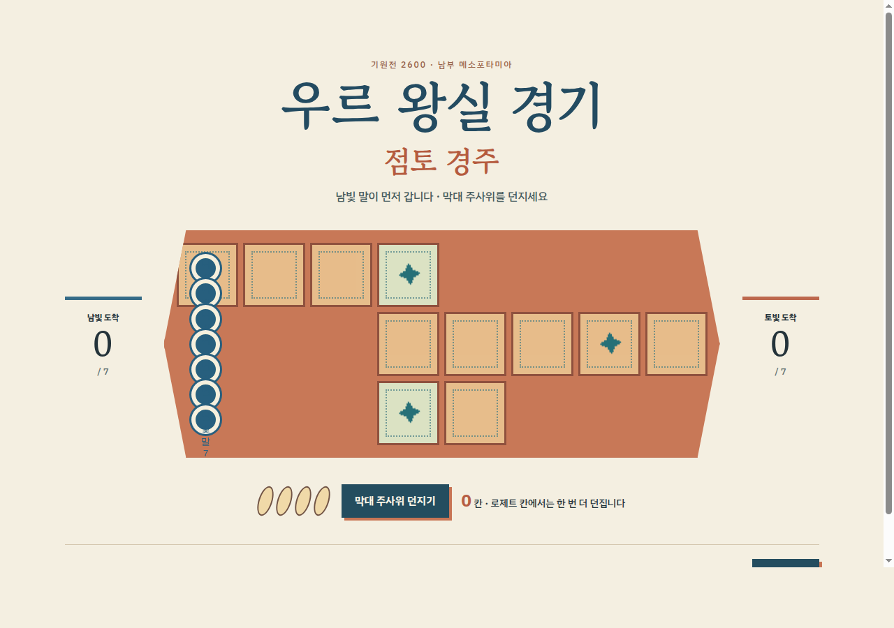
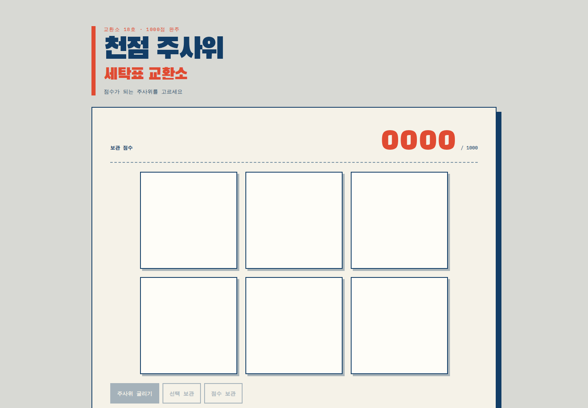
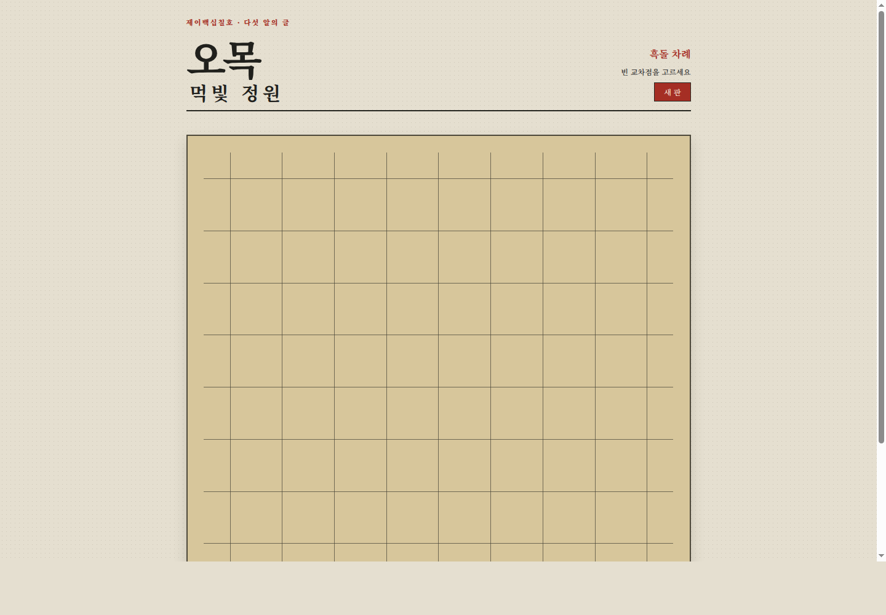
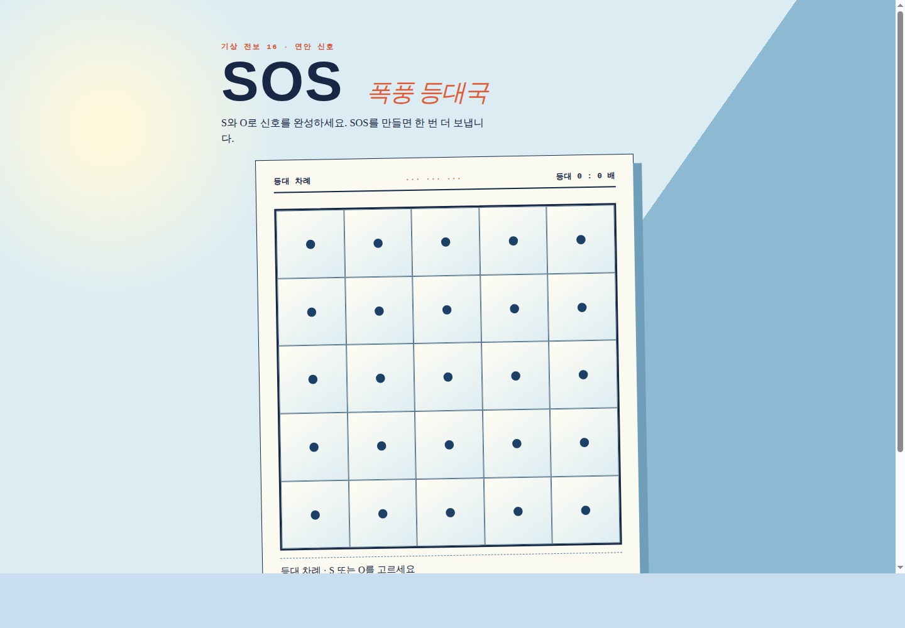
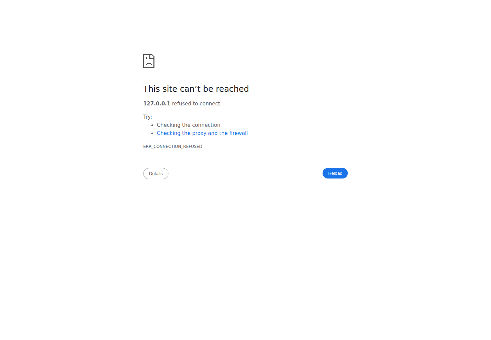
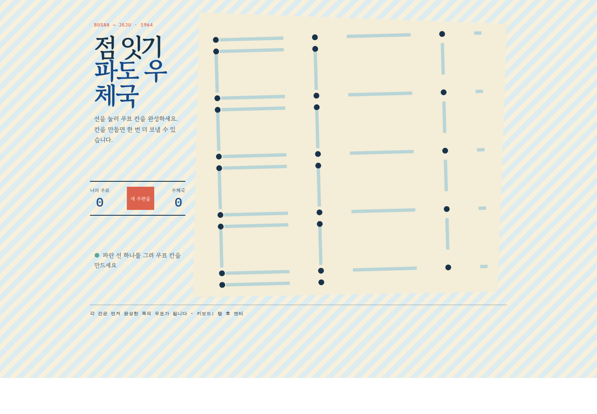
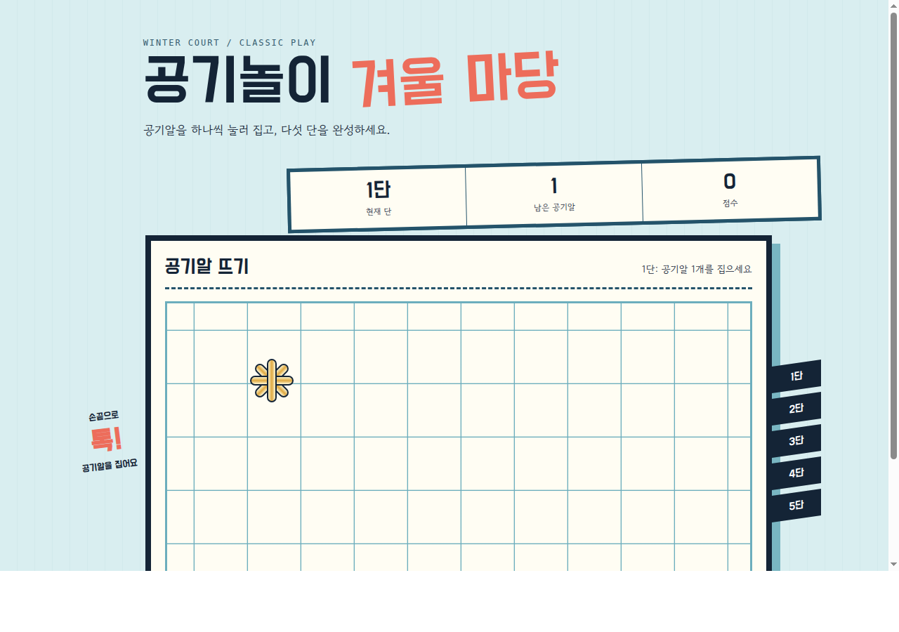
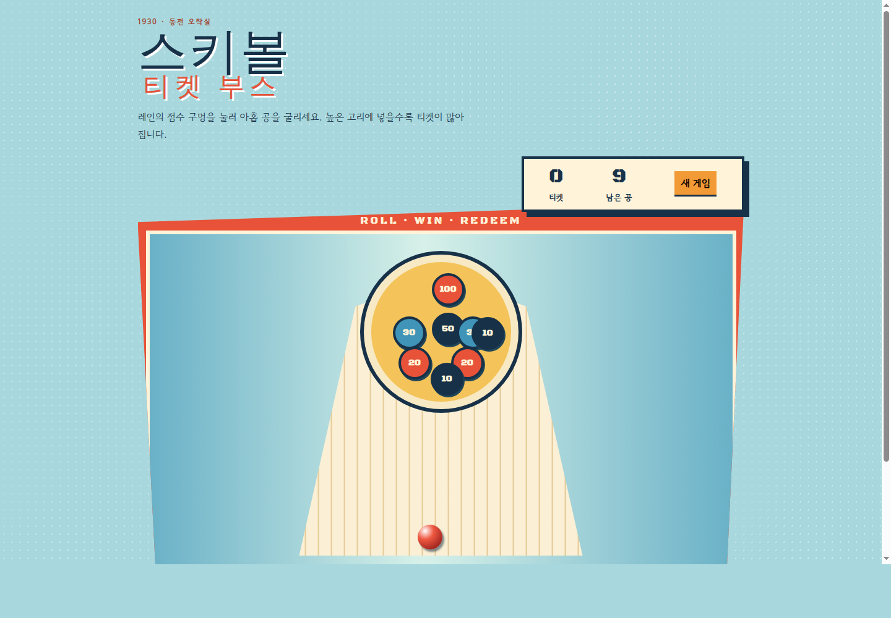
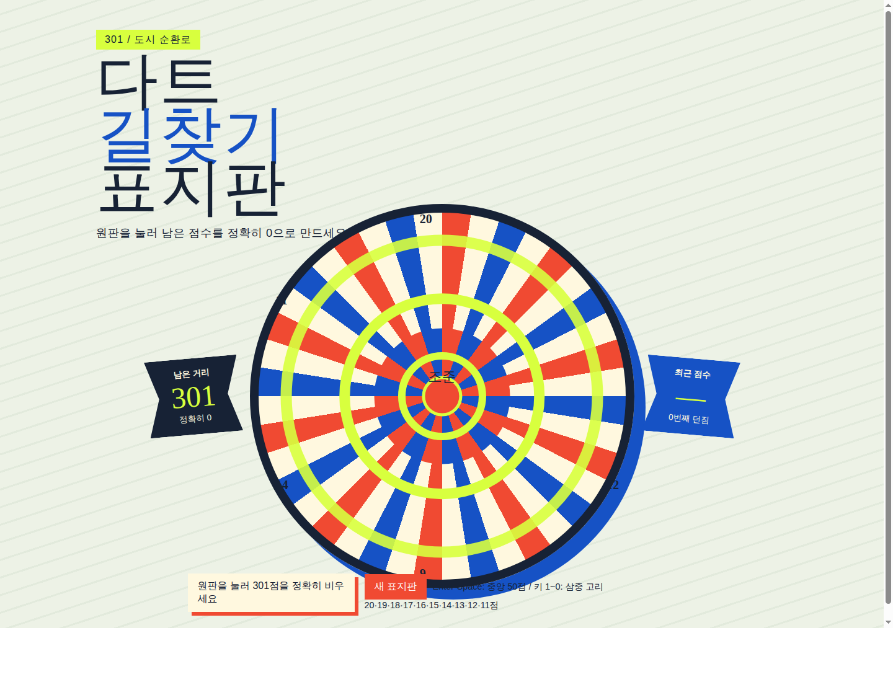

# 데일리 클래식 게임

날짜별로 작은 클래식 브라우저 게임을 모아두는 저장소입니다. 각 게임은 새 의존성 없이 정적 HTML, CSS, JavaScript만 사용합니다.

이전 게임 설명과 화면은 [아카이브](archive/README-games.md)에 보관합니다.

## 최근 게임 목록

| 날짜 | 게임 | 설명 |
| --- | --- | --- |
| 2026-11-20 | [오와레 · 베틀 작업장](daily/2026-11-20-oware-weavers-loom/index.html) | 청남색 베틀 위 씨앗 상자에서 씨앗을 뿌리고 둘·셋 알이 된 상대 칸을 거두는 서아프리카 고전 오와레입니다. |
| 2026-11-19 | [우르 왕실 경기 · 점토 경주](daily/2026-11-19-ur-clay-race/index.html) | 테라코타 점토 경주길에서 남빛과 토빛 말을 로제트 칸으로 이끌어 일곱 말을 먼저 도착시키는 고전 우르 왕실 경기입니다. |
| 2026-11-18 | [천점 주사위 · 세탁표 교환소](daily/2026-11-18-farkle-laundry-token/index.html) | 회백색 세탁 전표 위에서 점수 눈을 골라 보관하며 1000점을 먼저 채우는 고전 천점 주사위입니다. |
| 2026-11-17 | [오목 · 먹빛 정원](daily/2026-11-17-gomoku-ink-garden/index.html) | 종이 섬유가 비치는 한지 격자에서 흑돌과 백돌을 놓아 다섯 알을 먼저 잇는 고전 오목입니다. |
| 2026-11-16 | [SOS · 폭풍 등대국](daily/2026-11-16-sos-storm-lanterns/index.html) | 하늘빛 기상 전보의 5×5 신호판에 S와 O를 놓아 SOS를 더 많이 보내는 고전 SOS입니다. |
| 2026-11-15 | [헥스 · 산호 산책로](daily/2026-11-15-hex-coral-walk/index.html) | 조개빛 수조의 육각 산책로에서 산호 해안을 위아래로 먼저 잇는 고전 헥스입니다. |
| 2026-11-14 | [점 잇기 · 파도 우체국](daily/2026-11-14-dots-post-office/index.html) | 바랜 항공우편 종이 위에서 선을 이어 우표 칸을 더 많이 차지하는 고전 점 잇기입니다. |
| 2026-11-13 | [공기놀이 · 겨울 마당](daily/2026-11-13-jacks-courtyard/index.html) | 하늘빛 고무 코트의 공기알을 하나씩 집어 다섯 단을 완성하는 고전 공기놀이입니다. |
| 2026-11-12 | [스키볼 · 티켓 부스](daily/2026-11-12-skee-ball-ticket-booth/index.html) | 민트 동전 오락실의 세로 레인에서 점수 포켓을 눌러 아홉 공의 티켓을 모으는 고전 스키볼입니다. |
| 2026-11-11 | [다트 · 길찾기 표지판](daily/2026-11-11-darts-wayfinding/index.html) | 형광 길찾기 표지판 다트 원판을 눌러 301점을 정확히 비우는 고전 다트 게임입니다. |

## 최근 게임 화면

### 오와레 · 베틀 작업장


[게임 파일](daily/2026-11-20-oware-weavers-loom/index.html) · [모바일 화면](daily/2026-11-20-oware-weavers-loom/screenshot-mobile.png) · [디자인 비교와 검증](daily/2026-11-20-oware-weavers-loom/DESIGN.md)

### 우르 왕실 경기 · 점토 경주



[게임 파일](daily/2026-11-19-ur-clay-race/index.html) · [모바일 화면](daily/2026-11-19-ur-clay-race/screenshot-mobile.png) · [디자인 비교와 검증](daily/2026-11-19-ur-clay-race/DESIGN.md)

### 천점 주사위 · 세탁표 교환소



[게임 파일](daily/2026-11-18-farkle-laundry-token/index.html) · [모바일 화면](daily/2026-11-18-farkle-laundry-token/screenshot-mobile.png) · [디자인 비교와 검증](daily/2026-11-18-farkle-laundry-token/DESIGN.md)

### 오목 · 먹빛 정원



[게임 파일](daily/2026-11-17-gomoku-ink-garden/index.html) · [모바일 화면](daily/2026-11-17-gomoku-ink-garden/screenshot-mobile.png) · [디자인 비교와 검증](daily/2026-11-17-gomoku-ink-garden/DESIGN.md)

### SOS · 폭풍 등대국



[게임 파일](daily/2026-11-16-sos-storm-lanterns/index.html) · [모바일 화면](daily/2026-11-16-sos-storm-lanterns/screenshot-mobile.png) · [디자인 비교와 검증](daily/2026-11-16-sos-storm-lanterns/DESIGN.md)

### 헥스 · 산호 산책로



[게임 파일](daily/2026-11-15-hex-coral-walk/index.html) · [모바일 화면](daily/2026-11-15-hex-coral-walk/screenshot-mobile.png) · [디자인 비교와 검증](daily/2026-11-15-hex-coral-walk/DESIGN.md)

### 점 잇기 · 파도 우체국



[게임 파일](daily/2026-11-14-dots-post-office/index.html) · [모바일 화면](daily/2026-11-14-dots-post-office/screenshot-mobile.png) · [디자인 비교와 검증](daily/2026-11-14-dots-post-office/DESIGN.md)

### 공기놀이 · 겨울 마당



[게임 파일](daily/2026-11-13-jacks-courtyard/index.html) · [모바일 화면](daily/2026-11-13-jacks-courtyard/screenshot-mobile.png) · [디자인 비교와 검증](daily/2026-11-13-jacks-courtyard/DESIGN.md)

### 스키볼 · 티켓 부스



[게임 파일](daily/2026-11-12-skee-ball-ticket-booth/index.html) · [모바일 화면](daily/2026-11-12-skee-ball-ticket-booth/screenshot-mobile.png) · [디자인 비교와 검증](daily/2026-11-12-skee-ball-ticket-booth/DESIGN.md)

### 다트 · 길찾기 표지판



[게임 파일](daily/2026-11-11-darts-wayfinding/index.html) · [모바일 화면](daily/2026-11-11-darts-wayfinding/screenshot-mobile.png) · [디자인 비교와 검증](daily/2026-11-11-darts-wayfinding/DESIGN.md)


## 테스트

로직 테스트는 Node.js 내장 모듈만 사용합니다.

```bash
node daily/2026-11-20-oware-weavers-loom/game-logic.test.js
node daily/2026-11-19-ur-clay-race/game-logic.test.js
node daily/2026-11-18-farkle-laundry-token/game-logic.test.js
node daily/2026-11-17-gomoku-ink-garden/game-logic.test.js
node daily/2026-11-16-sos-storm-lanterns/game-logic.test.js
node daily/2026-11-15-hex-coral-walk/game-logic.test.js
node daily/2026-11-14-dots-post-office/game-logic.test.js
node daily/2026-11-13-jacks-courtyard/game-logic.test.js
node daily/2026-11-12-skee-ball-ticket-booth/game-logic.test.js
node daily/2026-11-11-darts-wayfinding/game-logic.test.js
node daily/2026-11-09-marble-flick-yard/game-logic.test.js
node daily/2026-11-07-set-solar-studio/game-logic.test.js
node daily/2026-11-06-pachisi-river-scroll/game-logic.test.js
node daily/2026-11-05-puluc-clay-studio/game-logic.test.js
node daily/2026-11-04-shut-the-box-shell/game-logic.test.js
node daily/2026-11-03-memory-quilt/game-logic.test.js
node daily/2026-11-02-fan-tan-market/game-logic.test.js
node daily/2026-11-01-pig-dice-tea-tin/game-logic.test.js
node daily/2026-10-31-cribbage-cloth-table/game-logic.test.js
node daily/2026-10-30-paper-football-scoreboard/game-logic.test.js
node daily/2026-10-29-peg-solitaire-orbit/game-logic.test.js
node daily/2026-10-28-pong-gymnasium/game-logic.test.js
node daily/2026-10-27-backgammon-travel-poster/game-logic.test.js
node daily/2026-10-26-chinese-checkers-festival/game-logic.test.js
node daily/2026-10-25-ninepins-seaside/game-logic.test.js
node daily/2026-10-23-klotski-studio/game-logic.test.js
node daily/2026-10-21-quoridor-subway/game-logic.test.js
node daily/2026-10-20-yahtzee-letterpress/game-logic.test.js
node daily/2026-10-19-simon-glasshouse-chimes/game-logic.test.js
node daily/2026-10-18-battleship-blueprint/game-logic.test.js
node daily/2026-10-16-mini-sudoku-origami/game-logic.test.js
node daily/2026-10-14-pylos-lily-greenhouse/game-logic.test.js
node daily/2026-10-13-bingo-lifeguard-board/game-logic.test.js
node daily/2026-10-11-kakuro-tea-ledger/game-logic.test.js
node daily/2026-10-10-reversi-picnic-cloth/game-logic.test.js
node daily/2026-10-09-lights-out-rain-lab/game-logic.test.js
node daily/2026-10-08-hanoi-library-ladder/game-logic.test.js
node daily/2026-10-07-lunar-lander-kite-festival/game-logic.test.js
node daily/2026-10-06-yutnori-roofyard/game-logic.test.js
node daily/2026-10-05-2048-printshop/game-logic.test.js
node daily/2026-10-04-snake-signal/game-logic.test.js
node daily/2026-10-03-atari-go-clay-grid/game-logic.test.js
node daily/2026-10-02-mastermind-punchcard/game-logic.test.js
node daily/2026-10-01-minesweeper-weather-map/game-logic.test.js
node daily/2026-09-30-pente-neon-court/game-logic.test.js
node daily/2026-09-29-boggle-typecase/game-logic.test.js
node daily/2026-09-28-kalaha-tide-pools/game-logic.test.js
node daily/2026-09-27-mini-draughts/game-logic.test.js
node daily/2026-09-26-alquerque/game-logic.test.js
node daily/2026-09-25-connect-four/game-logic.test.js
node daily/2026-09-24-fifteen-puzzle/game-logic.test.js
node daily/2026-09-23-tic-tac-toe/game-logic.test.js
node daily/2026-09-22-nim-sticks/game-logic.test.js
node daily/2026-09-20-fox-and-geese/game-logic.test.js
node daily/2026-09-14-shuffleboard/game-logic.test.js
node daily/2026-09-13-bagatelle/game-logic.test.js
node daily/2026-09-12-ming-mang/game-logic.test.js
node daily/2026-09-11-awithlaknannai/game-logic.test.js
node daily/2026-09-10-mini-fanorona/game-logic.test.js
node daily/2026-09-09-umul-gonu/game-logic.test.js
node daily/2026-09-08-latrunculi/game-logic.test.js
node daily/2026-09-07-shisima/game-logic.test.js
node daily/2026-09-06-mini-hasami-shogi/game-logic.test.js
node daily/2026-09-05-seega/game-logic.test.js
node daily/2026-09-04-mini-halma/game-logic.test.js
node daily/2026-09-03-frog-leap/game-logic.test.js
node daily/2026-09-02-yote/game-logic.test.js
node daily/2026-09-01-dara/game-logic.test.js
node daily/2026-08-31-picaria/game-logic.test.js
node daily/2026-08-30-chopsticks/game-logic.test.js
node daily/2026-08-29-six-mens-morris/game-logic.test.js
node daily/2026-08-28-five-field-kono/game-logic.test.js
node daily/2026-08-27-tafl/game-logic.test.js
node daily/2026-08-26-gaps-solitaire/game-logic.test.js
node daily/2026-08-25-quarto/game-logic.test.js
node daily/2026-08-24-mini-freecell/game-logic.test.js
node daily/2026-08-23-dominoes/game-logic.test.js
node daily/2026-08-22-crazy-eights/game-logic.test.js
node daily/2026-08-21-klondike-solitaire/game-logic.test.js
node daily/2026-08-20-nonogram/game-logic.test.js
node daily/2026-08-19-aces-up-solitaire/game-logic.test.js
node daily/2026-08-18-peg-solitaire/game-logic.test.js
node daily/2026-08-17-teeko/game-logic.test.js
```
