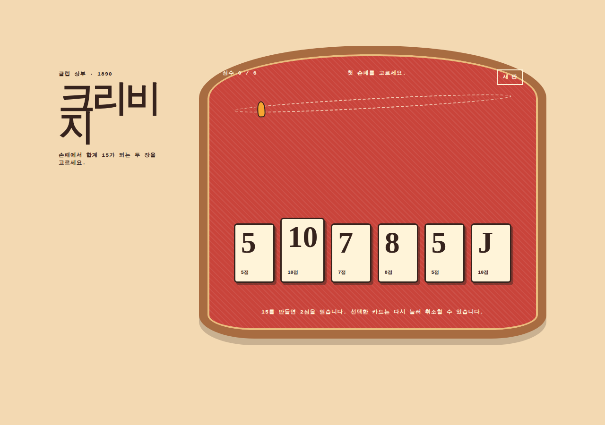
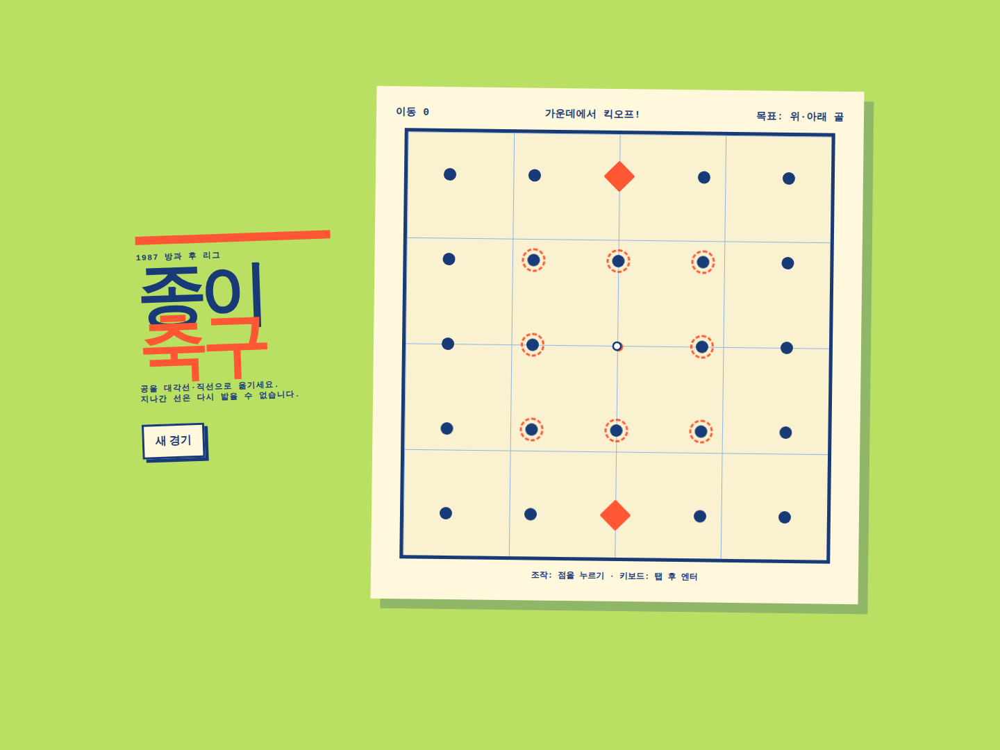
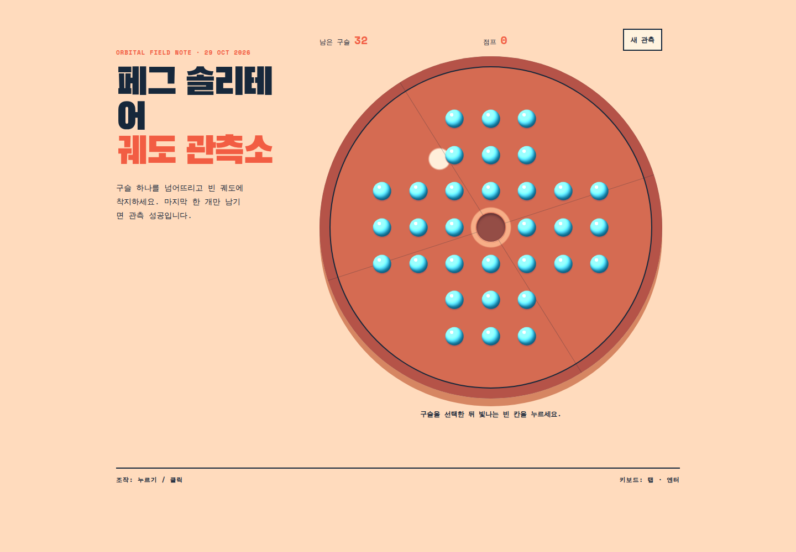
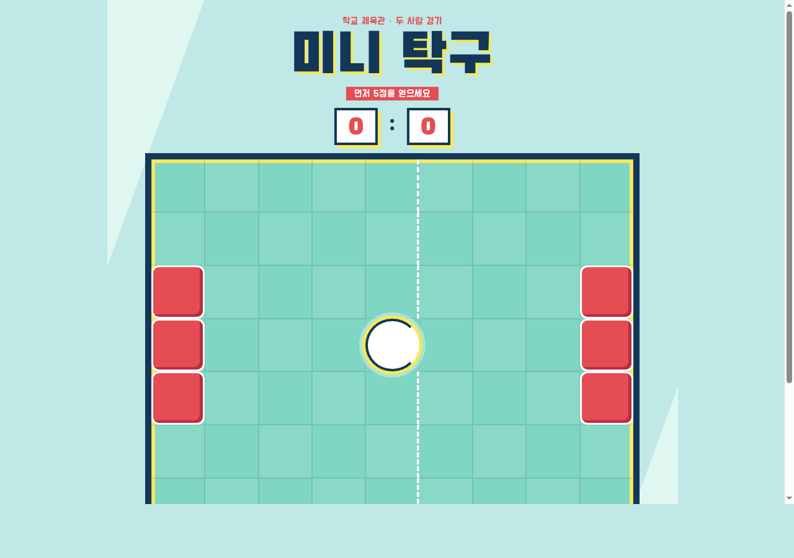
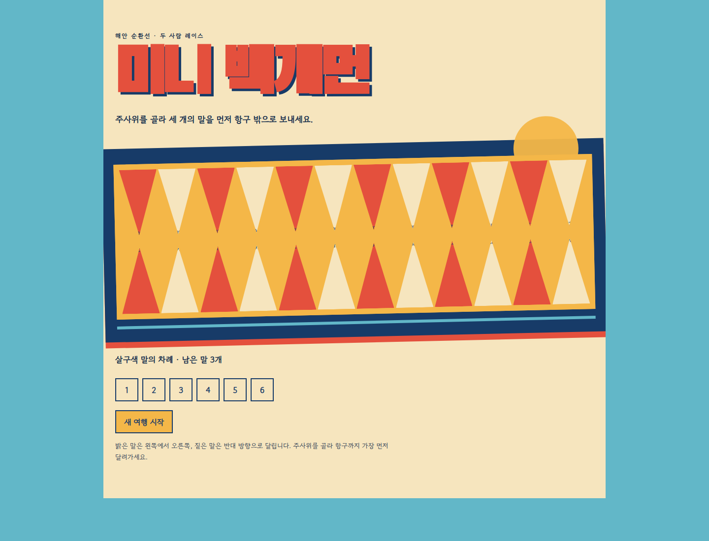
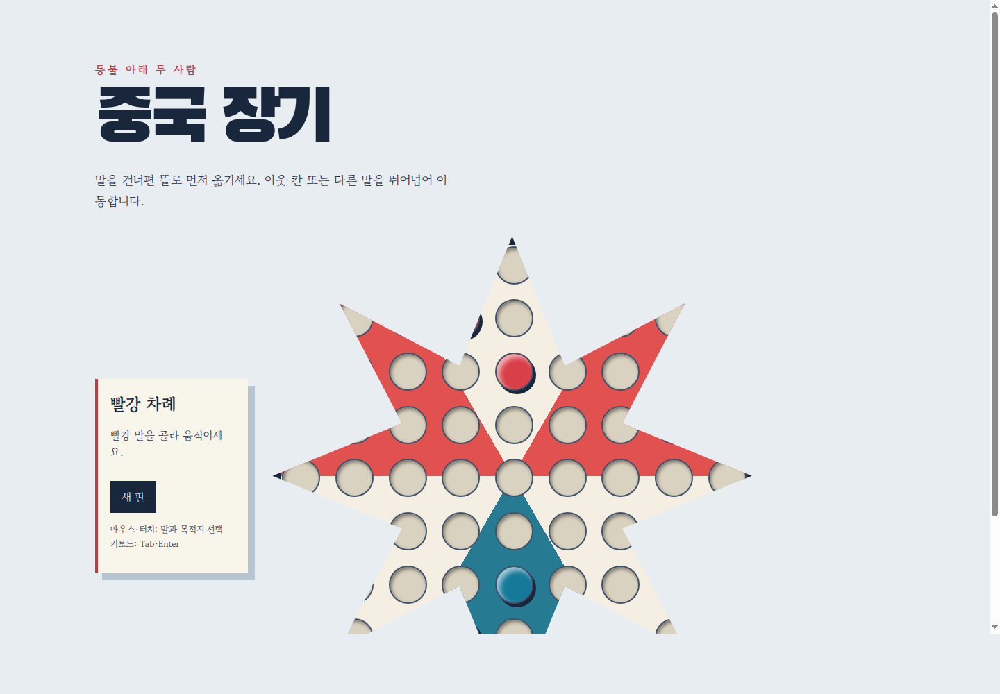
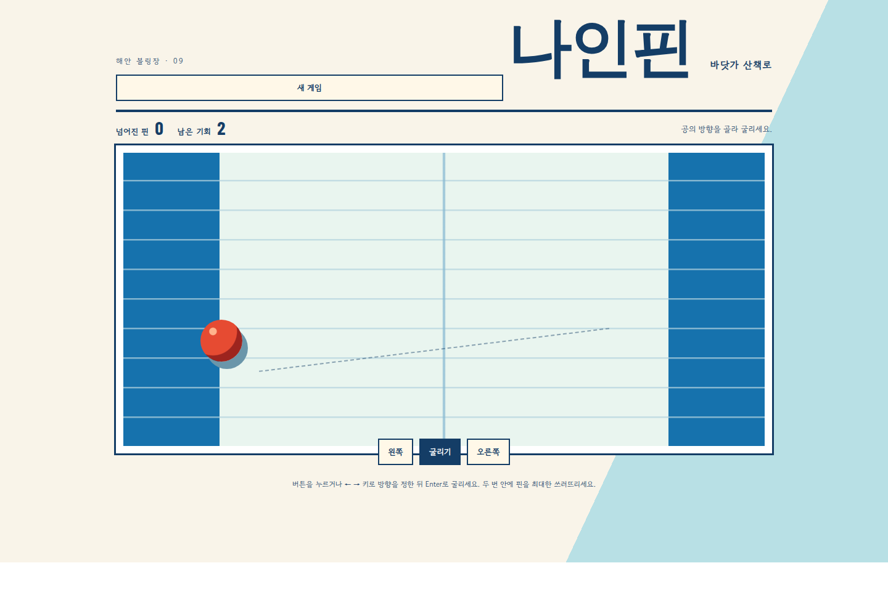
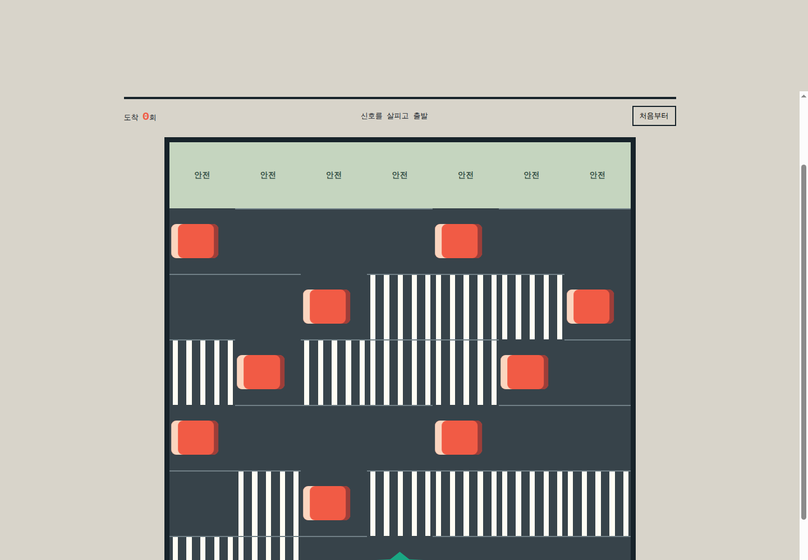
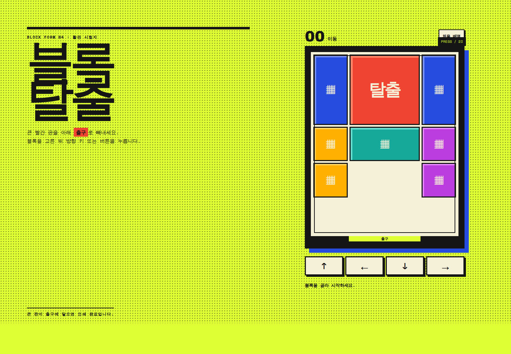

# 데일리 클래식 게임

날짜별로 작은 클래식 브라우저 게임을 모아두는 저장소입니다. 각 게임은 새 의존성 없이 정적 HTML, CSS, JavaScript만 사용합니다.

이전 게임 설명과 화면은 [아카이브](archive/README-games.md)에 보관합니다.

## 최근 게임 목록

| 날짜 | 게임 | 설명 |
| --- | --- | --- |
| 2026-10-31 | [크리비지 · 붉은 천 테이블](daily/2026-10-31-cribbage-cloth-table/index.html) | 붉은 펠트 테이블에서 합계 15가 되는 손패 두 장을 골라 핀을 옮기는 고전 크리비지입니다. |
| 2026-10-30 | [종이 축구 · 점수판](daily/2026-10-30-paper-football-scoreboard/index.html) | 공책 격자 경기장에서 지나간 선을 피하며 위·아래 골대까지 공을 잇는 고전 종이 축구입니다. |
| 2026-10-29 | [페그 솔리테어 · 궤도 관측소](daily/2026-10-29-peg-solitaire-orbit/index.html) | 살구빛 원형 관측판에서 구슬을 뛰어넘어 마지막 한 개만 남기는 고전 페그 솔리테어입니다. |
| 2026-10-28 | [미니 탁구 · 오전 체육관](daily/2026-10-28-pong-gymnasium/index.html) | 밝은 학교 체육관 코트에서 패들을 움직여 공을 받아내는 두 사람 고전 탁구입니다. |
| 2026-10-27 | [미니 백개먼 · 여행 포스터](daily/2026-10-27-backgammon-travel-poster/index.html) | 해안 순환선 포스터의 대각 항로에서 세 말을 먼저 항구 밖으로 보내는 미니 백개먼 레이스입니다. |
| 2026-10-26 | [중국 장기 · 종이등 마당](daily/2026-10-26-chinese-checkers-festival/index.html) | 종이등 빛의 별 모양 마당에서 말을 뛰어넘어 건너편 뜰을 먼저 채우는 중국 장기입니다. |
| 2026-10-25 | [나인핀 · 바닷가 산책로](daily/2026-10-25-ninepins-seaside/index.html) | 푸른 타일 레인에서 두 번의 공으로 아홉 핀을 최대한 쓰러뜨리는 고전 나인핀 게임입니다. |
| 2026-10-24 | [개구리 길건너기 · 횡단보도 관제함](daily/2026-10-24-frogger-crosswalk/index.html) | 아침 교차로의 흐르는 차량 사이를 가로질러 안전지대에 닿는 고전 개구리 길건너기입니다. |
| 2026-10-23 | [블록 탈출 · 형광 인쇄소](daily/2026-10-23-klotski-studio/index.html) | 형광 안전표지 인쇄소의 세로 활판 틀에서 큰 빨간 블록을 출구까지 빼내는 고전 화룽도 퍼즐입니다. |
| 2026-10-22 | [점과 상자 · 리소그래프 작업대](daily/2026-10-22-dots-and-boxes-risograph/index.html) | 크림 리소그래프 종이 위에 자홍·청록 잉크 선을 이어 상자를 더 많이 인쇄하는 고전 점과 상자 게임입니다. |

## 최근 게임 화면

### 크리비지 · 붉은 천 테이블



[게임 파일](daily/2026-10-31-cribbage-cloth-table/index.html) · [모바일 화면](daily/2026-10-31-cribbage-cloth-table/screenshot-mobile.png) · [디자인 비교와 검증](daily/2026-10-31-cribbage-cloth-table/DESIGN.md)

### 종이 축구 · 점수판



[게임 파일](daily/2026-10-30-paper-football-scoreboard/index.html) · [모바일 화면](daily/2026-10-30-paper-football-scoreboard/screenshot-mobile.png) · [디자인 비교와 검증](daily/2026-10-30-paper-football-scoreboard/DESIGN.md)

### 페그 솔리테어 · 궤도 관측소



[게임 파일](daily/2026-10-29-peg-solitaire-orbit/index.html) · [모바일 화면](daily/2026-10-29-peg-solitaire-orbit/screenshot-mobile.png) · [디자인 비교와 검증](daily/2026-10-29-peg-solitaire-orbit/DESIGN.md)

### 미니 탁구 · 오전 체육관



[게임 파일](daily/2026-10-28-pong-gymnasium/index.html) · [모바일 화면](daily/2026-10-28-pong-gymnasium/screenshot-mobile.png) · [디자인 비교와 검증](daily/2026-10-28-pong-gymnasium/DESIGN.md)

### 미니 백개먼 · 여행 포스터



[게임 파일](daily/2026-10-27-backgammon-travel-poster/index.html) · [모바일 화면](daily/2026-10-27-backgammon-travel-poster/screenshot-mobile.png) · [디자인 비교와 검증](daily/2026-10-27-backgammon-travel-poster/DESIGN.md)

### 중국 장기 · 종이등 마당



[게임 파일](daily/2026-10-26-chinese-checkers-festival/index.html) · [모바일 화면](daily/2026-10-26-chinese-checkers-festival/screenshot-mobile.png) · [디자인 비교와 검증](daily/2026-10-26-chinese-checkers-festival/DESIGN.md)

### 나인핀 · 바닷가 산책로



[게임 파일](daily/2026-10-25-ninepins-seaside/index.html) · [모바일 화면](daily/2026-10-25-ninepins-seaside/screenshot-mobile.png) · [디자인 비교와 검증](daily/2026-10-25-ninepins-seaside/DESIGN.md)

### 개구리 길건너기 · 횡단보도 관제함



[게임 파일](daily/2026-10-24-frogger-crosswalk/index.html) · [모바일 화면](daily/2026-10-24-frogger-crosswalk/screenshot-mobile.png) · [디자인 비교와 검증](daily/2026-10-24-frogger-crosswalk/DESIGN.md)

### 블록 탈출 · 형광 인쇄소



[게임 파일](daily/2026-10-23-klotski-studio/index.html) · [모바일 화면](daily/2026-10-23-klotski-studio/screenshot-mobile.png) · [디자인 비교와 검증](daily/2026-10-23-klotski-studio/DESIGN.md)

### 점과 상자 · 리소그래프 작업대


[게임 파일](daily/2026-10-22-dots-and-boxes-risograph/index.html) · [모바일 화면](daily/2026-10-22-dots-and-boxes-risograph/screenshot-mobile.png) · [디자인 비교와 검증](daily/2026-10-22-dots-and-boxes-risograph/DESIGN.md)

## 테스트

로직 테스트는 Node.js 내장 모듈만 사용합니다.

```bash
node daily/2026-10-31-cribbage-cloth-table/game-logic.test.js
node daily/2026-10-30-paper-football-scoreboard/game-logic.test.js
node daily/2026-10-29-peg-solitaire-orbit/game-logic.test.js
node daily/2026-10-28-pong-gymnasium/game-logic.test.js
node daily/2026-10-27-backgammon-travel-poster/game-logic.test.js
node daily/2026-10-26-chinese-checkers-festival/game-logic.test.js
node daily/2026-10-25-ninepins-seaside/game-logic.test.js
node daily/2026-10-24-frogger-crosswalk/game-logic.test.js
node daily/2026-10-23-klotski-studio/game-logic.test.js
node daily/2026-10-22-dots-and-boxes-risograph/game-logic.test.js
node daily/2026-10-21-quoridor-subway/game-logic.test.js
node daily/2026-10-20-yahtzee-letterpress/game-logic.test.js
node daily/2026-10-19-simon-glasshouse-chimes/game-logic.test.js
node daily/2026-10-18-battleship-blueprint/game-logic.test.js
node daily/2026-10-16-mini-sudoku-origami/game-logic.test.js
node daily/2026-10-14-pylos-lily-greenhouse/game-logic.test.js
node daily/2026-10-13-bingo-lifeguard-board/game-logic.test.js
node daily/2026-10-11-kakuro-tea-ledger/game-logic.test.js
node daily/2026-10-10-reversi-picnic-cloth/game-logic.test.js
node daily/2026-10-09-lights-out-rain-lab/game-logic.test.js
node daily/2026-10-08-hanoi-library-ladder/game-logic.test.js
node daily/2026-10-07-lunar-lander-kite-festival/game-logic.test.js
node daily/2026-10-06-yutnori-roofyard/game-logic.test.js
node daily/2026-10-05-2048-printshop/game-logic.test.js
node daily/2026-10-04-snake-signal/game-logic.test.js
node daily/2026-10-03-atari-go-clay-grid/game-logic.test.js
node daily/2026-10-02-mastermind-punchcard/game-logic.test.js
node daily/2026-10-01-minesweeper-weather-map/game-logic.test.js
node daily/2026-09-30-pente-neon-court/game-logic.test.js
node daily/2026-09-29-boggle-typecase/game-logic.test.js
node daily/2026-09-28-kalaha-tide-pools/game-logic.test.js
node daily/2026-09-27-mini-draughts/game-logic.test.js
node daily/2026-09-26-alquerque/game-logic.test.js
node daily/2026-09-25-connect-four/game-logic.test.js
node daily/2026-09-24-fifteen-puzzle/game-logic.test.js
node daily/2026-09-23-tic-tac-toe/game-logic.test.js
node daily/2026-09-22-nim-sticks/game-logic.test.js
node daily/2026-09-20-fox-and-geese/game-logic.test.js
node daily/2026-09-14-shuffleboard/game-logic.test.js
node daily/2026-09-13-bagatelle/game-logic.test.js
node daily/2026-09-12-ming-mang/game-logic.test.js
node daily/2026-09-11-awithlaknannai/game-logic.test.js
node daily/2026-09-10-mini-fanorona/game-logic.test.js
node daily/2026-09-09-umul-gonu/game-logic.test.js
node daily/2026-09-08-latrunculi/game-logic.test.js
node daily/2026-09-07-shisima/game-logic.test.js
node daily/2026-09-06-mini-hasami-shogi/game-logic.test.js
node daily/2026-09-05-seega/game-logic.test.js
node daily/2026-09-04-mini-halma/game-logic.test.js
node daily/2026-09-03-frog-leap/game-logic.test.js
node daily/2026-09-02-yote/game-logic.test.js
node daily/2026-09-01-dara/game-logic.test.js
node daily/2026-08-31-picaria/game-logic.test.js
node daily/2026-08-30-chopsticks/game-logic.test.js
node daily/2026-08-29-six-mens-morris/game-logic.test.js
node daily/2026-08-28-five-field-kono/game-logic.test.js
node daily/2026-08-27-tafl/game-logic.test.js
node daily/2026-08-26-gaps-solitaire/game-logic.test.js
node daily/2026-08-25-quarto/game-logic.test.js
node daily/2026-08-24-mini-freecell/game-logic.test.js
node daily/2026-08-23-dominoes/game-logic.test.js
node daily/2026-08-22-crazy-eights/game-logic.test.js
node daily/2026-08-21-klondike-solitaire/game-logic.test.js
node daily/2026-08-20-nonogram/game-logic.test.js
node daily/2026-08-19-aces-up-solitaire/game-logic.test.js
node daily/2026-08-18-peg-solitaire/game-logic.test.js
node daily/2026-08-17-teeko/game-logic.test.js
```
